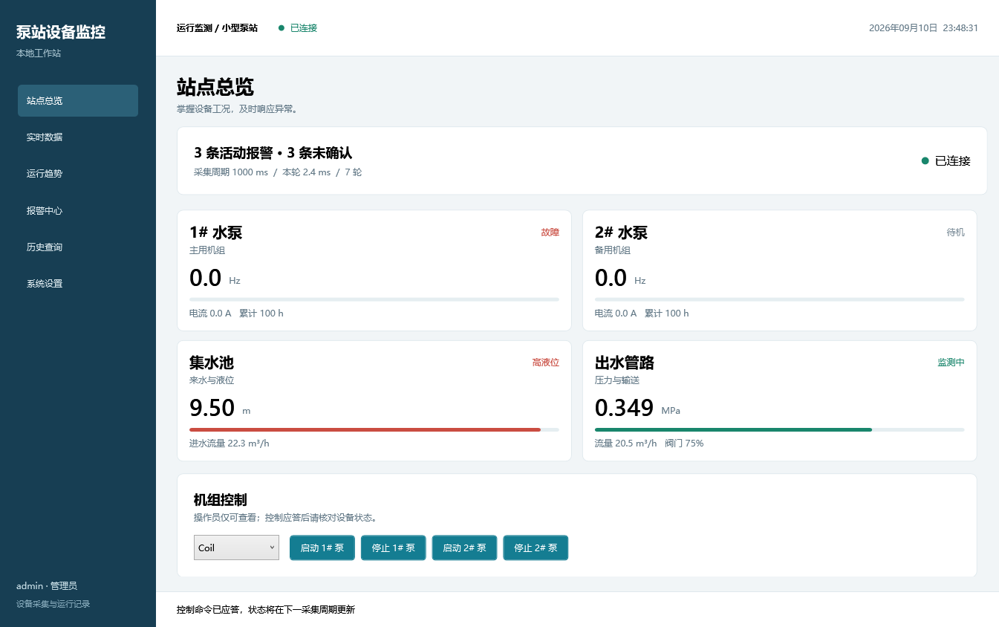
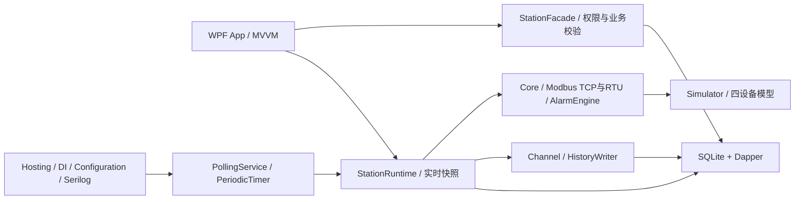

# 泵站设备监控上位机

可离线演示的 WPF 工业监控项目：两台水泵、集水池、出水管路，23 个默认点位。自带 Modbus TCP 模拟器，无需硬件。



## 直接运行

双击根目录 **Start-Demo.cmd**。它启动模拟器和监控界面，命令窗口可输入故障注入命令。

- 管理员：`admin` / `Admin123!`
- 操作员：`operator` / `Operator123!`
- 默认通信：`127.0.0.1:1502`，站号 1。
- 模拟器命令：`fault 1`、`fault 2`、`level 9.5`、`offline`、`recover`、`quit`。

自带运行时的 Windows x64 版本输出到 `artifacts/release/App` 和 `artifacts/release/Simulator`。源码仓库不包含这些构建产物；首次使用一键脚本时若没有发布文件，会自动构建，需要 .NET 10 SDK。移动已发布程序时必须复制整个目录，不能只复制 exe。

## 功能

登录与角色权限、四设备总览、实时点位与质量戳、1/5/15/60 分钟趋势、报警产生/恢复/确认、时间筛选与 CSV、历史查询与播放/暂停/进度拖动、TCP/RTU 设置、点表与报警规则管理、用户管理、历史保留与泵启停。

## 架构



## 开发与验证

```powershell
dotnet restore --locked-mode
dotnet build -c Release
dotnet test -c Release
powershell -NoProfile -ExecutionPolicy Bypass -File scripts/Verify.ps1 -Seconds 600
```

App 目标为 `net10.0-windows10.0.19041.0`，其余项目 `net10.0`。最低 Windows 10 2004，当前在本机 .NET SDK 10.0.400 验收。解决方案是传统 `.sln`；VS 2022 是否支持该 SDK 未验收，命令行构建已通过。

[完整运行手册](docs/README.md) · [学习指南](docs/STUDY_GUIDE.md) · [演示脚本](docs/DEMO.md) · [技术决策](docs/DECISIONS.md) · [实测指标](docs/METRICS.md) · [异常审计](docs/AUDIT.md)

[项目全解与面试问答](docs/PumpStationMonitor项目全解与面试问答.md)：完整项目讲解、200 道面试问答，以及 13 道基础面试题的概念解释与自然表达。

RTU 报文与客户端已实现，实际串口/虚拟串口链路未验证。历史查询和 CSV 每次最多 10,000 条，更多数据请缩小时间范围。
