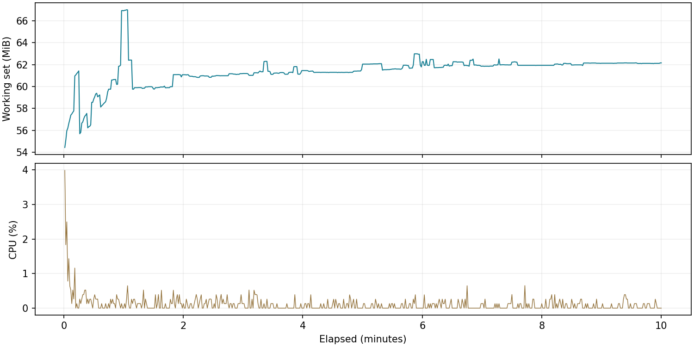
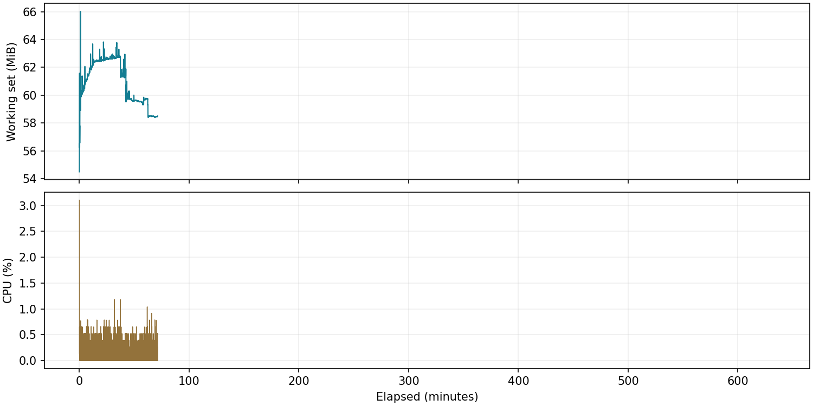
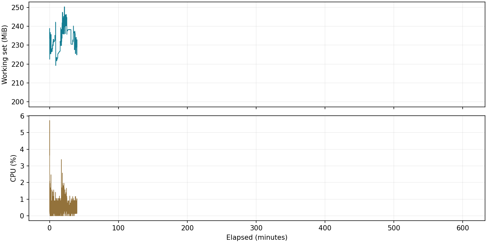
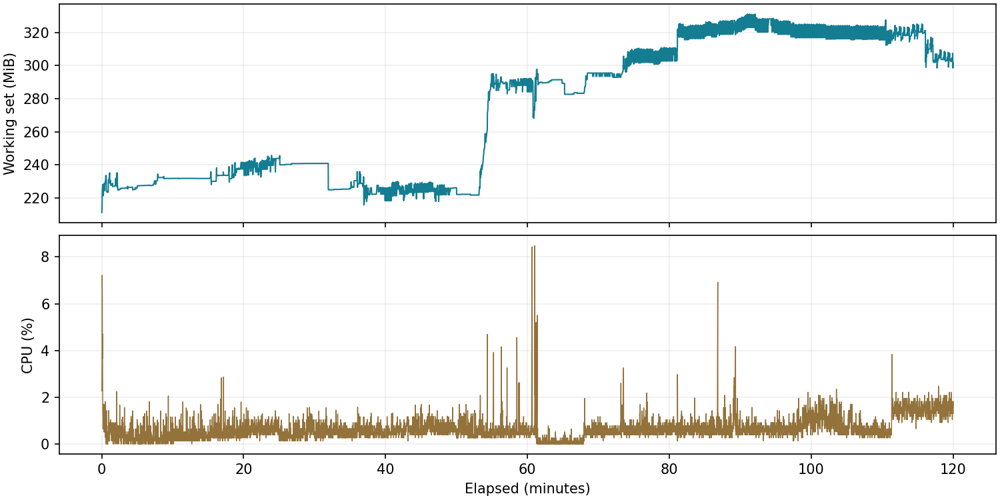

# 实测指标

环境：Windows x64，.NET SDK 10.0.400，12 个逻辑处理器，Release，loopback TCP。CPU 百分比按整机逻辑处理器数量归一化。下列数字只代表本机模拟负载。

## 已完成检查

- 功能自动测试：57 项通过、0 失败，见 `evidence/full-tests.trx`。
- 实际 WPF 发布版登录、六页面、设置子页、故障报警、历史查询和操作员状态已渲染并保存截图。
- 早期采集宿主已连续运行超过 10 分钟；前 10 分钟的原始采样见 `evidence/host-first-10min.csv`。该版本尚未合并相邻寄存器，不能用于宣称最终版本的轮询耗时。
- 最终分组采集版本已完成 600 秒宿主验证，汇总见下文。

## SQLite 查询基准

同一单点历史库，按设备、点位及覆盖全数据的时间段查询，按时间排序，LIMIT 10000；1 次预热，随后 5 次测量。这里测的是带索引读取前 10,000 条，不是完整扫描或取回全表。

| 历史总行数 | 返回行数 | 平均 ms | 最小 ms | 最大 ms |
|---|---|---|---|---|
| 100,000 | 10,000 | 24.06 | 21.34 | 27.73 |
| 500,000 | 10,000 | 18.18 | 14.53 | 22.03 |

50 万库更快主要受缓存和运行噪声影响，不能据此推断数据越多查询越快。原始结果：`evidence/benchmark.json`。

## 两小时稳定性

最终 WPF 复测已达到连续两小时采样，见下文。

## 持续运行最终记录

### 最终采集宿主 10 分钟

墙钟经过 600.20 秒，最长连续采样 600.00 秒；采集 600 轮；数据库 13,800 行。

- 工作集峰值 67.00 MiB，末 10 分钟平均 61.35 MiB。
- CPU 平均 0.111%，峰值 3.988%，按整机逻辑核数归一化。
- 轮询耗时平均 2.159 ms，采样 P95 2.261 ms。
- 无效采样秒数 0；连续时长复核 通过，超过 5 秒的间隔 0 次。

原始 CSV / JSON：`evidence/final-host-10min-runtime.csv`、`evidence/final-host-10min-summary.json`。

### 早期采集宿主 2 小时

墙钟经过 38020.67 秒，最长连续采样 4282.00 秒；采集 4,239 轮；数据库 97,497 行。

- 工作集峰值 66.02 MiB，末 10 分钟平均 58.61 MiB。
- CPU 平均 0.135%，峰值 3.106%，按整机逻辑核数归一化。
- 轮询耗时平均 5.218 ms，采样 P95 6.220 ms。
- 无效采样秒数 0；连续时长复核 未通过（采样中断，不能按墙钟时长认定），超过 5 秒的间隔 1 次。

原始 CSV / JSON：`evidence/endurance-runtime.csv`、`evidence/endurance-summary.json`。

### WPF 趋势页休眠中断记录

墙钟经过 36134.07 秒，最长连续采样 2391.02 秒；采集 2,400 轮；数据库 55,200 行。

- 工作集峰值 250.27 MiB，末 10 分钟平均 232.51 MiB。
- CPU 平均 0.482%，峰值 5.731%，按整机逻辑核数归一化。
- 轮询耗时平均 1.999 ms，采样 P95 2.359 ms。
- 无效采样秒数 0；连续时长复核 未通过（采样中断，不能按墙钟时长认定），超过 5 秒的间隔 1 次。

原始 CSV / JSON：`evidence/ui-release-endurance-runtime.csv`、`evidence/ui-release-endurance-summary.json`。

### 最终 WPF 连续 2 小时复测

墙钟经过 7200.39 秒，最长连续采样 7200.03 秒；采集 7,209 轮；数据库 262,154 行。

- 工作集峰值 331.16 MiB，末 10 分钟平均 313.81 MiB。
- CPU 平均 0.643%，峰值 8.489%，按整机逻辑核数归一化。
- 轮询耗时平均 1.857 ms，采样 P95 2.054 ms。
- 无效采样秒数 0；连续时长复核 通过，超过 5 秒的间隔 0 次。

原始 CSV / JSON：`evidence/ui-endurance-verified-runtime.csv`、`evidence/ui-endurance-verified-summary.json`。
