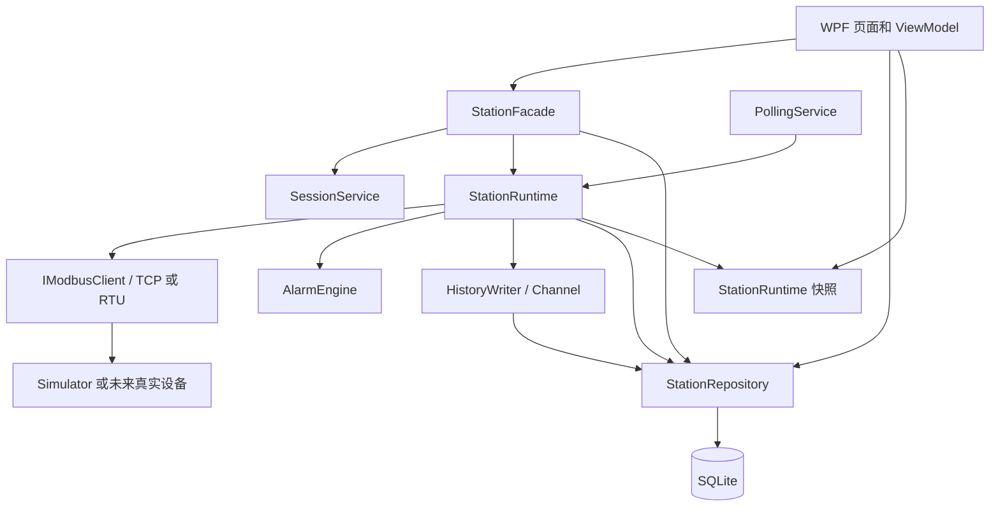
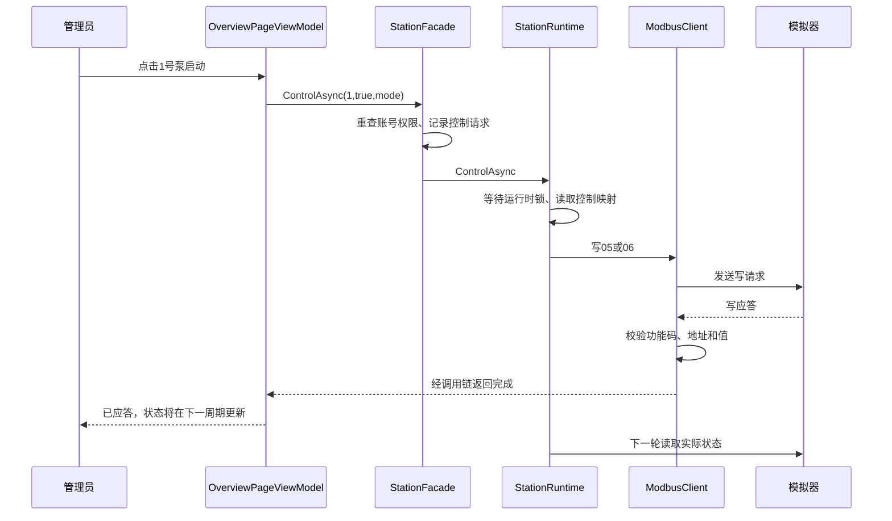
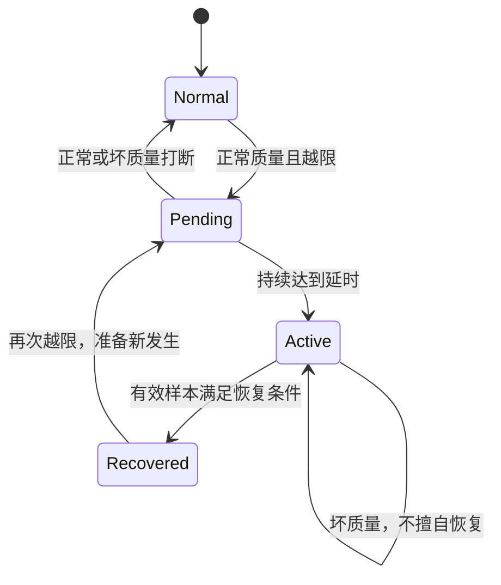

# 泵站设备监控上位机：项目全解与面试问答

> 项目：PumpStationMonitor｜整理日期：2026-09-28｜面向：C# / WPF / 上位机 / 工业通信岗位。
>
> 本文以当前工作区源码为依据，结合项目任务背景、测试、运行手册和原始性能记录整理。基线提交为 `853275709de48bc8f12006a04484d9524d8442c2`；工作区原有解决方案及客户端文件修改也纳入阅读。本文只新增资料，不改业务实现。
>
> 阅读目标：能从一个界面数值追到原始报文，能解释每项设计的原因和代价，能在追问时指出代码、测试与限制。后文提供 **200 道带回答的面试题**，覆盖常见问题及深入追问；另在第28章补充 **13道基础面试题的自然表达版**，侧重概念解释。实际面试无法穷举，遇到新题可沿“现状—原理—证据—边界—改进”作答。

## 目录

1. [项目定位与一分钟全貌](#overview)
2. [业务模型、完整点表与默认配置](#model)
3. [工程分层、文件职责与依赖](#architecture)
4. [六条必须讲清的端到端流程](#flows)
5. [Modbus 协议与报文手算](#protocol)
6. [客户端：并发、超时、重试与释放](#client)
7. [采集：分组、解码、质量与快照](#polling)
8. [报警：延时、死区、确认与恢复](#alarms)
9. [数据库、历史队列与一致性](#storage)
10. [WPF、MVVM、趋势与回放](#ui)
11. [登录权限、配置与控制](#security)
12. [模拟器、测试与性能证据](#verification)
13. [已知限制、容易说错的点与改进路线](#limits)
14. [面试问答 001—025：项目、架构与选型](#qa-project)
15. [面试问答 026—060：Modbus 与通信](#qa-protocol)
16. [面试问答 061—085：C#、异步与并发](#qa-concurrency)
17. [面试问答 086—105：采集、点表与数据质量](#qa-polling)
18. [面试问答 106—125：报警状态机](#qa-alarms)
19. [面试问答 126—150：数据库与历史持久化](#qa-storage)
20. [面试问答 151—170：WPF、MVVM 与界面性能](#qa-ui)
21. [面试问答 171—185：权限、安全与部署](#qa-security)
22. [面试问答 186—200：测试、性能、扩展与项目真实性](#qa-testing)
23. [故障排查手册](#troubleshooting)
24. [项目介绍、简历表达与连续追问示例](#interview)
25. [五分钟演示、断点路线与现场练习](#practice)
26. [复习安排与最后检查清单](#review)
27. [源码索引、证据与参考资料](#sources)
28. [基础面试题1—13：自然表达与概念解释](#interview-basics)

<a id="overview"></a>
## 1. 项目定位与一分钟全貌

### 1.1 这个项目到底做什么

这是一套运行在 Windows 上的泵站设备监控桌面软件。它向设备读取寄存器和状态位，把原始数据转换成液位、压力、电流等工程量，显示实时状态与曲线；当数值或状态满足报警条件时记录报警；同时保存历史数据，允许授权用户启停水泵、查询历史和维护配置。

演示环境由两个独立进程组成：**WPF 上位机**和**Modbus TCP 从站模拟器**。模拟器提供两台水泵、一个集水池和一段出水管路的状态；无真实 PLC 也能复现读写、超时、报警和恢复。

准确定位是“具备完整业务流程的本地工业监控个人项目”。现有证据来自本机模拟器，不能据此声称已经在工厂投产、连接真实 PLC 或承担安全联锁。

### 1.2 上位机、PLC、模拟器各管什么

| 对象 | 责任 | 本项目对应 |
|---|---|---|
| 上位机 | 展示、查询、报警管理、配置、人工控制请求 | WPF App 与后台服务 |
| 下位机 / PLC | 现场信号采集、执行机构控制、设备侧逻辑 | 当前由 Simulator 模拟 |
| Modbus | 规定读写数据的报文与交互格式 | 自研客户端和模拟服务端 |
| 数据库 | 保存配置、采样历史和报警发生记录 | SQLite |

**主用、备用、远程、自动是当前模拟状态与界面标识，不代表已经实现泵组轮换、自动液位调节、PID 或完整联锁逻辑。**

### 1.3 六个页面与后台能力

| 页面 / 能力 | 当前行为 |
|---|---|
| 登录 | 管理员、操作员；密码散列；失败节流 |
| 站点总览 | 四设备卡片、关键工程量、质量判断、泵启停 |
| 实时数据 | 23 个默认点位；值、单位、地址、质量、采样时间 |
| 运行趋势 | 点位选择；1 / 5 / 15 / 60 分钟窗口 |
| 报警中心 | 当前与历史报警、确认、时间筛选、报警 CSV 导出 |
| 历史查询 | 设备 / 点位 / 时间过滤，表格、曲线、进度回放 |
| 系统设置 | 通信、点位、规则、用户、保留天数 |
| 后台采集 | 按周期轮询、合并相邻地址、断线重连 |
| 历史保存 | 有界队列、批量事务、定期清理、退出排空 |

源码中的 CSV 导出入口是**报警记录导出**，不要把它泛化成已实现“所有历史采样全量导出”。

### 1.4 最值得讲的五项设计

1. **通信正确性**：明确帧边界、验证事务号和写应答，整次请求串行执行。
2. **控制结果的不确定性**：读可以有限重试，写应答丢失不自动重发。
3. **数据可信度**：数值带质量和时间；失联不显示为正常的 0。
4. **报警生命周期**：延时、死区、发生编号、恢复与确认独立，重载保留活动报警。
5. **采集与存储协调**：Channel 背压、批次事务、停止顺序与有限时间排空。

<a id="model"></a>
## 2. 业务模型、完整点表与默认配置

### 2.1 设备、点位、采样不是同一件事

- **设备**：例如 `pump1`，拥有设备名称和 Modbus 站号。
- **点位定义**：例如 `pump1_current`，定义功能码、地址、比例、偏移、数据类型等。
- **一次采样**：例如某时刻电流 12.5 A，质量 Good，时间为一个 UTC 时间戳。
- **快照**：一轮采集得到的全部点位值，以及连接状态、耗时、轮次、更新时间和错误。
- **报警规则**：例如液位 `>= 8 m` 持续 1 秒产生 H 报警。
- **报警发生记录**：某条规则在某次故障中的具体发生实例，有唯一 GUID。

`TagDefinition`、`TagSample` 是 Core 的基础模型；实际配置和页面常用 `TagRow`，它还包含 `DataType`、`ByteOrder`、`Enabled`。不要把基础 `TagDefinition` 说成包含所有配置字段。

### 2.2 完整默认点表：23 个逻辑点

地址为报文中的**零基地址**。默认四个业务设备的 `UnitId` 都是 1，共用同一模拟站点。

| ID | 设备 | 名称 | 功能码 | 地址 | 位 | 换算 / 单位 |
|---|---|---|---:|---:|---:|---|
| pump1_run | pump1 | 1# 泵运行 | 03 | 0 | 0 | 0 / 1 |
| pump1_fault | pump1 | 1# 泵故障 | 03 | 0 | 1 | 0 / 1 |
| pump1_remote | pump1 | 1# 泵远程 | 03 | 0 | 2 | 0 / 1 |
| pump1_auto | pump1 | 1# 泵自动 | 03 | 0 | 3 | 0 / 1 |
| pump1_current | pump1 | 1# 泵电流 | 03 | 1 | — | × 0.1 A |
| pump1_frequency | pump1 | 1# 泵频率 | 03 | 2 | — | × 0.1 Hz |
| pump1_hours | pump1 | 1# 泵累计运行 | 03 | 3 | — | h |
| pump1_command | pump1 | 1# 泵启停命令位 | 01 | 0 | — | 0 / 1 |
| pump2_run | pump2 | 2# 泵运行 | 03 | 10 | 0 | 0 / 1 |
| pump2_fault | pump2 | 2# 泵故障 | 03 | 10 | 1 | 0 / 1 |
| pump2_remote | pump2 | 2# 泵远程 | 03 | 10 | 2 | 0 / 1 |
| pump2_auto | pump2 | 2# 泵自动 | 03 | 10 | 3 | 0 / 1 |
| pump2_current | pump2 | 2# 泵电流 | 03 | 11 | — | × 0.1 A |
| pump2_frequency | pump2 | 2# 泵频率 | 03 | 12 | — | × 0.1 Hz |
| pump2_hours | pump2 | 2# 泵累计运行 | 03 | 13 | — | h |
| pump2_command | pump2 | 2# 泵启停命令位 | 01 | 1 | — | 0 / 1 |
| level | sump | 集水池液位 | 03 | 20 | — | × 0.01 m |
| inflow | sump | 进水流量 | 03 | 21 | — | × 0.1 m³/h |
| high_switch | sump | 高液位开关 | 03 | 22 | 0 | 0 / 1 |
| low_switch | sump | 低液位开关 | 03 | 22 | 1 | 0 / 1 |
| pressure | outlet | 出口压力 | 03 | 30 | — | × 0.001 MPa |
| outflow | outlet | 出口流量 | 03 | 31 | — | × 0.1 m³/h |
| valve | outlet | 阀门开度 | 03 | 32 | — | × 0.1 % |

计算：两台泵各 8 点，集水池 4 点，出水管路 3 点，总计 `8 × 2 + 4 + 3 = 23`。多个逻辑点可以共用一个物理寄存器，因此点数不等于寄存器数。

### 2.3 控制映射与模拟地址

| 控制方式 | 1# 泵 | 2# 泵 | 值 |
|---|---:|---:|---|
| 写单线圈 05 | 0 | 1 | 开 `FF00`；关 `0000` |
| 写单寄存器 06 | 40 | 41 | 默认启动 1，停止 0 |

映射来自 `CommunicationSettings.PumpControls`。运行时查字典和设备站号，不再通过泵号拼地址。线圈方式直接写布尔量；`StartValue` / `StopValue` 用于寄存器方式。

模拟器还有输入寄存器区 04、离散输入区 02 和 `100～127` 自由读写演示区。每个数据区长度 128，超出模拟器范围返回异常码 02。协议允许的寻址空间比模拟器实现范围大。

**命令位不等于实际运行位**：线圈可能仍为 1，但泵处于故障，状态寄存器中的运行位为 0。

### 2.4 默认通信与关键容量

| 项目 | 默认值 / 限制 |
|---|---|
| TCP | `127.0.0.1:1502`，站号 1 |
| RTU | `COM5`，9600 baud，8 位，偶校验，1 停止位 |
| App 采集周期 | 1000 ms |
| App 请求单次超时 | 1000 ms |
| App 读重试次数 | 2，连同初次最多 3 次 |
| 客户端默认退避 | 200 ms 起，指数增长，单次最多 10000 ms |
| 历史保留 | 30 天 |
| 历史 Channel | 20000 条，满时等待 |
| 历史批次 | 最多 200 条，或约 1 秒刷新 |
| UI 刷新定时器 | 250 ms |
| 活动报警刷新 | 每 8 次有效 UI 回调，通常约 2 秒 |
| 过期阈值 | `max(3000 ms, 3 × 采集周期)` |
| 趋势缓存 | 每点最多 1 小时且不超过 36000 条 |
| 趋势显示 | 约 1500 点以内 |
| 历史页面查询 | 默认最多 10000 行 |
| 历史曲线显示 | 约 2000 点以内 |
| 历史清理 | 采集服务首次成功轮询后及之后约每小时，分块 5000 行 |

区分两层默认值：裸 `ModbusOptions` 的 `Timeout` 为 **2 秒**；App 的 `CommunicationSettings.TimeoutMs` 为 **1 秒**，创建客户端时覆盖前者。测试还会使用 100 / 300 ms 等独立配置。

<a id="architecture"></a>
## 3. 工程分层、文件职责与依赖

### 3.1 工程结构

```text
PumpStationMonitor
├─ src
│  ├─ PumpStationMonitor.Core
│  │  ├─ Protocol       帧编解码、客户端、接口、连接状态
│  │  ├─ Models         点位、采样、位与浮点转换
│  │  ├─ Alarms         报警规则和状态机
│  │  ├─ Services       配置、快照与业务数据契约
│  │  └─ Diagnostics    日志适配、连续运行判定
│  ├─ PumpStationMonitor.Data
│  │  ├─ Services       采集运行时、采集调度、历史消费者
│  │  ├─ Security       密码散列、登录与权限
│  │  ├─ StationRepository.cs   数据访问
│  │  ├─ StationFacade.cs       修改、控制、确认与导出的业务入口
│  │  ├─ Bootstrap.cs          宿主与依赖装配
│  │  ├─ Seed.cs               首次建库默认数据
│  │  └─ schema.sql            七张表和索引
│  ├─ PumpStationMonitor.App
│  │  ├─ Views / Pages        登录、主窗口、六个页面
│  │  ├─ ViewModels           页面模型与刷新协调
│  │  └─ App.xaml.cs          启动和关闭
│  └─ PumpStationMonitor.Simulator
│     ├─ StationState.cs      模拟状态与 PDU 处理
│     └─ ModbusServer.cs      TCP 收发和模型时钟
├─ examples                  协议演示、无界面采集宿主
├─ tests                     协议、通信、报警、存储、连续性测试
├─ scripts                   验证、发布与指标整理
└─ docs                      说明与原始证据
```

### 3.2 依赖与运行关系



工程引用是 `App → Data → Core`，`Simulator → Core`；Tests 引用 Core、Data、Simulator。Core 不引用 WPF，也不访问数据库。App 的只读查询会直接调用 Repository，不能说成“所有读写都经过 Facade”。

这不是严格的六边形架构或完整整洁架构：Data 项目同时承载持久化与业务编排，Repository 也没有全面接口化。优点是小项目结构直接；继续扩展时可把应用服务、设备接入和数据库基础设施进一步拆开。

### 3.3 技术选型与代价

| 选型（仓库版本） | 为什么适合 | 代价 / 不应夸大的地方 |
|---|---|---|
| C# / .NET 10 | 异步、类型系统、宿主与 Windows 桌面生态 | App 是 Windows 桌面程序；没有跨平台 UI |
| WPF | 数据绑定、模板、成熟桌面控件体系 | Dispatcher 线程约束；大量更新需要控制开销 |
| CommunityToolkit.Mvvm 8.4.2 | 生成属性通知和异步命令，减少重复代码 | 需要理解生成后的行为，不能只会贴特性 |
| HandyControl 3.5.1 | 提供主题和常用控件 | 需管理资源样式及版本兼容 |
| LiveCharts2 2.0.5 | 实时和历史曲线 | 原生图形依赖及曲线重绘成本 |
| Hosting 10.0.12 | 集中管理后台服务、DI、配置与关闭 | 注册顺序和服务生命周期必须理解 |
| 自研 Modbus | 可以掌握报文字节和失败语义 | 测试成本高，不能宣称等同成熟工业驱动 |
| SQLite 10.0.12 + Dapper 2.1.79 | 单机部署简单，SQL 可控，映射轻量 | 单写者、迁移需自行设计；异步 API 有限制 |
| Channel | 有界异步生产消费队列 | 内存队列不具备断电持久化能力 |
| Serilog | 结构化日志、按天文件、控制审计 | Debug 报文量大；本地日志可被修改 |
| xUnit | 纯算法与真实 TCP / SQLite 集成测试 | 通过测试不代表真实设备兼容或生产安全 |

版本来自项目文件，表示本仓库选型，不表示它们是最新或推荐版本。

<a id="flows"></a>
## 4. 六条必须讲清的端到端流程

### 4.1 启动：从进程到可登录界面

1. `App.OnStartup` 调用 `Bootstrap.Create`，装配配置、日志、仓储、运行时和后台服务。
2. 注册登录、主窗口、页面 ViewModel 和刷新协调器。
3. `Bootstrap.InitializeAsync` 建表、写默认配置和初始账号；已有数据库优先。
4. `host.StartAsync` 启动历史消费者和采集服务。
5. 显示登录窗口；后台采集已经可以运行，登录不是采集启动条件。
6. 登录成功触发 `SignedIn`，初始化页面配置、当前报警和 UI 定时刷新，再显示主窗口。

### 4.2 一次液位采样如何到屏幕

```text
PollingService
  → StationRuntime.PollAsync
  → 根据点表确定 sump / 03 / 地址20～22
  → ModbusClientBase.ReadRegistersAsync
  → ExecuteAsync（门锁、超时、重试）
  → ModbusTcpClient.ExchangeAsync
  → ModbusFrames.Tcp → TCP发送
  → 模拟器 ModbusServer → StationState.Respond
  → 响应按 MBAP 长度读取 → 帧校验 → PDU校验
  → ushort[] → 第0个原始值950
  → Scale=0.01 → 9.50m
  → HistoryWriter.EnqueueAsync
  → AlarmEngine.Evaluate → 报警落库
  → 发布 StationSnapshot
  → PageRefreshCoordinator → 实时行 / 总览 / 趋势
```

历史入队不等于历史已落库；快照发布前会等待本轮报警持久化，但历史由另一个消费者批量提交。

### 4.3 启泵控制如何完成



收到协议应答表示本次写请求得到设备确认，不直接证明电机已实际运转。当前没有独立的“下发后立即回读并判定控制完成”状态机，主要靠下一轮采集反馈。写超时会记录结果未知并提示后续回读，不会自动重发。

### 4.4 越限、确认、恢复

`level 9.5` → 模型液位寄存器变成 950 → 采集换算为 9.5 → H / HH 分别计时 → 到达延时生成各自的 OccurrenceId → 插入报警记录 → 页面刷新看到活动报警。

用户确认时，App 走 `StationFacade.AcknowledgeAsync → StationRepository.AcknowledgeAsync`，更新确认人和确认时间。随后 `recover` 清除强制液位；后续正常样本跨过恢复阈值，更新同一个报警记录的恢复时间。

**真实界面确认路径没有调用 `AlarmEngine.Acknowledge`**。引擎方法存在并有单元测试；运行应用采用数据库确认，以支持已经恢复但尚未确认的历史报警。回答时要区分这两条路径。

### 4.5 保存配置如何生效

权限和参数校验 → 等待 Runtime 门锁 → 先刷待写报警 → 修改数据库 → 释放旧客户端 → 重读配置、点位和规则 → 重建报警引擎并恢复活动报警 ID → 创建新客户端 → 下一次通信连接 → 刷新各页面配置。

当前保存点位或规则也会重建客户端；这简单可靠，但成本较大。配置数据库写入与内存重载不是一个可自动回滚的跨资源事务，重载失败需要明确诊断。

### 4.6 关闭如何减少历史丢失

窗口关闭先取消立即退出 → 停 UI 定时器 → `host.StopAsync` → 先停 PollingService → 后停 HistoryWriter → Channel 生产端完成 → 批量排空 → 释放 Runtime / 客户端和宿主 → `Application.Shutdown`。

HistoryWriter 注册在 PollingService 前，在默认顺序关闭下由后注册服务先停止。宿主关闭时限 30 秒；历史排空单独最多 20 秒。数据库持续不可用或进程被强杀时不能保证所有内存记录落库。

<a id="protocol"></a>
## 5. Modbus 协议与报文手算

### 5.1 数据区与功能码

| 十进制 / 十六进制 | 含义 | 数据 |
|---|---|---|
| 1 / 0x01 | 读线圈 | 可写布尔区，响应位打包 |
| 2 / 0x02 | 读离散输入 | 只读布尔区，响应位打包 |
| 3 / 0x03 | 读保持寄存器 | 16 位寄存器 |
| 4 / 0x04 | 读输入寄存器 | 只读 16 位寄存器 |
| 5 / 0x05 | 写单线圈 | `FF00` 或 `0000` |
| 6 / 0x06 | 写单寄存器 | 一个 16 位值 |
| 16 / 0x10 | 写多个寄存器 | 数量、字节数和数据 |

代码的 `16` 是十进制，报文里显示为 `10`。本项目不支持 0x0F 写多线圈，也不支持广播写；统一只允许站号 1～247。这是实现范围，不能说 TCP 规范中的 Unit Identifier 在所有场景都只可能取这些值。

### 5.2 PDU、ADU、MBAP

- PDU：`功能码 + 功能数据`。
- RTU ADU：`站号 + PDU + CRC`。
- TCP ADU：`MBAP头 + PDU`。

MBAP 为 7 字节：

| 字节偏移 | 长度 | 含义 |
|---:|---:|---|
| 0 | 2 | Transaction Identifier，事务号 |
| 2 | 2 | Protocol Identifier，本项目验证为 0 |
| 4 | 2 | Length，包含站号和后续 PDU |
| 6 | 1 | Unit Identifier，站号 |
| 7 | 变长 | PDU 起点 |

因此：**完整 TCP 帧长 = 6 + Length**；已读 7 字节头后，还需读 `Length - 1` 字节。TCP Modbus 不在尾部附加 RTU CRC。

### 5.3 手算读取液位

为了与前期调试例子一致，这里读输入寄存器 04；默认 App 点表的液位使用 03，模拟器会将保持寄存器周期镜像到输入区。

```text
站号：1；事务号：0x1234；功能码：04
起始地址：20(十进制)=0x0014；数量：1

PDU：04 00 14 00 01
TCP：12 34 00 00 00 06 01 04 00 14 00 01
     事务号 协议号 长度  站  功能 地址  数量

假设原始液位为950：950=0x03B6
响应PDU：04 02 03 B6
响应TCP：12 34 00 00 00 05 01 04 02 03 B6

03 B6 → 3×256+182=950 → 950×0.01=9.50m
```

响应中的 `02` 是**数据字节数**，不是“读了两个寄存器”。一个寄存器占两个字节。

### 5.4 你之前问过的那一行代码

```csharp
return Enumerable.Range(0, count)
    .Select(i => ModbusFrames.ReadUInt16(response.AsSpan(2 + i * 2)))
    .ToArray();
```

它只做一件事：**把响应 PDU 中的数据字节转换成 `ushort[]`。它不负责网络收发。**

```csharp
// 解释用的等价写法
ushort[] result = new ushort[count];
for (int i = 0; i < count; i++)
{
    int start = 2 + i * 2;
    result[i] = ModbusFrames.ReadUInt16(response.AsSpan(start));
}
return result;
```

- `Range(0, count)` 生成 0 到 count−1 的索引。
- `2` 跳过功能码和字节数。
- `i * 2` 跳过前面 i 个寄存器。
- `AsSpan(start)` 提供从 start 到结尾的视图，不复制底层数组。
- `ReadUInt16` 只取该视图开头两个字节，并按大端解释。
- `Select` 定义每个索引如何转换；`ToArray` 枚举并生成最终结果数组。

示例：`[03,04,00,0A,00,14]` → `[10,20]`。前两个数是十六进制功能码和字节数，最后得到的 10、20 是十进制寄存器值。

### 5.5 位打包与状态字

读取 9 个线圈需要 `ceil(9 / 8)=2` 个数据字节。第 i 位位于：

```csharp
int byteIndex = 2 + i / 8;
int bitIndex = i % 8;
bool value = (response[byteIndex] & (1 << bitIndex)) != 0;
```

最低地址线圈占首字节最低位。状态寄存器的位提取类似，但先从两个字节得到 `ushort`：`(word & (1 << bit)) != 0`。

模拟泵状态值 14 为二进制 `1110`：bit0 运行=0，bit1 故障=1，bit2 远程=1，bit3 自动=1。不能把“14”当作一个枚举状态号。

### 5.6 写报文和应答

```text
05 启动1#泵PDU：05 00 00 FF 00
06 写地址40为1：06 00 28 00 01
10 从100写入0x1234、0xABCD：
10 00 64 00 02 04 12 34 AB CD
│  地址  数量  字节数  数据

10 应答：10 00 64 00 02
```

05 / 06 应答回显功能码、地址和值；0x10 应答回显功能码、起始地址和数量。`ValidateResponse` 对比请求前 5 字节，并验证响应长度为 5。不能只看到功能码相同就认定写入成功。

### 5.7 CRC16 与大小端

本项目算法：初值 `FFFF`；每字节与 CRC 异或；处理 8 次最低位；最低位为 1 时右移并异或 `A001`，否则只右移。CRC 覆盖站号和 PDU，不覆盖 CRC 自身。

已知测试向量：

```text
数据：01 03 00 00 00 0A
CRC数值：0xCDC5
线上帧：01 03 00 00 00 0A C5 CD
```

寄存器和 MBAP 多字节字段采用大端；RTU CRC 低字节先发送。大小端不是整套协议所有字段一律同一种。

### 5.8 Float32 和工程量

Float32 占两个寄存器。假定标准字节序为 A B C D：

| 配置 | 接收到的排列 | 转换目的 |
|---|---|---|
| Abcd | A B C D | 直接解释 |
| Badc | B A D C | 交换每个寄存器内部字节 |
| Cdab | C D A B | 交换两个寄存器 |
| Dcba | D C B A | 四字节反序 |

代码先重排，再用 `Int32BitsToSingle` 将位模式解释为浮点数；不是把整数数值强制转换成 float。已知向量 `42 F6 E9 79` 约为 `123.456f`。之后才做 `engineering = raw × Scale + Offset`。

Int16 用 `unchecked((short)word)` 保留 16 位补码意义，`FFFF` 解释为 −1。Float32 最后一个起始地址不能是 65535，否则第二个寄存器越界。

<a id="client"></a>
## 6. 客户端：并发、超时、重试与释放

### 6.1 接口与模板方法

`IModbusClient` 暴露读位、读寄存器、写线圈、写单 / 多寄存器、连接状态事件和异步释放。`ModbusClientBase` 负责公共策略；TCP / RTU 子类实现 `ConnectAsync`、`ExchangeAsync`、`Disconnect`。

这使重试、取消和功能校验保持一致，传输层只关心字节如何往返。接口用于隔离调用方式；基类用于复用算法骨架，两者作用不同。

### 6.2 为什么需要覆盖整次请求的 SemaphoreSlim

`gate = new(1,1)` 使同一客户端同时只有一个请求执行“连接—发送—读取—校验”。锁的范围还包括该请求的重试退避，后续请求需要等它完整结束。

如果只锁发送，多个调用仍可能同时读同一条流，造成 B 读走 A 的响应。事务号能检测不匹配，但不能把被别的读取者拿走的字节自动找回来。

代码先 `await gate.WaitAsync(token)`，成功获取后才进入 `try/finally`；等待期间取消时不会错误地 `Release`。`finally` 无论成功、异常或取消都释放已取得的许可。

### 6.3 超时与重试时间账

每次尝试创建 linked CancellationTokenSource，链接外部取消，并设置本次超时。预算覆盖本次连接和收发，不包括请求门锁排队；退避使用外部 token，也不计入单次超时。

```text
App默认：Timeout=1s，Retries=2，RetryDelay=0.2s
第1次尝试最多约1s → 等0.2s
第2次尝试最多约1s → 等0.4s
第3次尝试最多约1s → 失败
理想化合计约3.6s，另加排队、调度及少量处理开销。
```

这不是硬实时上限：某些底层调用的取消能力有限，串口打开尤其如此。

### 6.4 四类结果的处理

| 情况 | 连接处理 | 重试 | 返回 |
|---|---|---|---|
| 合法正常应答 | Connected | 不需要 | 数据 / 完成 |
| 合法设备异常应答 | 保持 Connected | 不自动重试 | ModbusException |
| 读通信错误、坏帧或内部超时 | 断开旧连接 | 有限次数、指数退避 | 成功或最终异常 |
| 写通信错误或超时 | 断开旧连接 | 不自动重发 | 失败 / 结果可能未知 |
| 外部取消 | 终止当前操作、清理连接 | 不重试 | OperationCanceledException |

取消来源判断顺序很关键：先检查外部 token；如果不是用户 / 宿主取消，而是单次超时导致的取消，最终转换为 `TimeoutException`。

### 6.5 “自动重连”究竟是什么

不是后台另起线程永远探测设备。读请求失败后在允许次数内断开并重连；一次调用最终失败后，下一轮采集又发起新请求，于是再次尝试建立连接。默认没有熔断器、随机抖动退避或跨周期累计退避。

TCP 客户端复用非空连接对象，没有每轮先依赖 `TcpClient.Connected` 判断在线。实际收发失败才说明连接不可用；响应校验通过后才设置 Connected。

### 6.6 RTU 的实现与边界

RTU 使用 SerialPort，打开动作交给 `Task.Run`；发送前等待约 3.5 字符时间，高波特率采用 2 ms 等待，再清理输入缓存。先读 3 字节前缀：异常帧总长 5；读应答依据字节数；写应答总长 8；最后验证站号和 CRC。

取消时注册关闭端口，以中断部分驱动无法取消的读操作。但这不等于所有驱动调用都可靠可取消；也没有完整证明字符间隔检测、半双工收发切换、噪声恢复和物理链路兼容。

**当前验证包括 RTU 帧编解码，不包括真实或虚拟串口往返验收。**

<a id="polling"></a>
## 7. 采集：分组、解码、质量与快照

### 7.1 三层节奏要分开

| 节奏 | 默认 | 做什么 |
|---|---:|---|
| 模拟模型更新 | 200 ms | 更新寄存器里的设备状态 |
| 后台采集 | 1000 ms | 从协议读数、入队、评估报警、发布快照 |
| UI 定时刷新 | 250 ms | 展示最新快照、时钟、回放和过期状态 |

UI 250 ms 刷新不意味着设备每 250 ms 采样；轮询耗时 2 ms 也不意味着设备 500 Hz 采样。

### 7.2 23 点为什么是 6 次请求

先按 `(DeviceId, Function)` 分组，再在组内按地址排序，将相邻或重叠地址合成块。

| 块 | 设备 | 功能码 | 地址范围 | 逻辑点数 |
|---|---|---:|---|---:|
| 1 | pump1 | 03 | 0～3 | 7 |
| 2 | pump1 | 01 | 0 | 1 |
| 3 | pump2 | 03 | 10～13 | 7 |
| 4 | pump2 | 01 | 1 | 1 |
| 5 | sump | 03 | 20～22 | 4 |
| 6 | outlet | 03 | 30～32 | 3 |

虽然两个泵的线圈地址连续而且站号相同，当前仍因 DeviceId 不同分为两次读取。这样保持设备边界简单，但不是理论上的最少请求数。

`ReadBlocks` 把结束地址视为**不包含的右边界**。若 `tag.Address > end`，有空洞就切块；若新结束地址与块起点的跨度超过 125 寄存器或 2000 位，也切块。Float32 宽度为 2，其他类型为 1。

### 7.3 为什么不把整个地址段盲目读完

从地址 0 一口气读到 127 虽然少发请求，却可能读到真实设备不支持的空洞、不同更新语义的数据或昂贵区域，导致整块拒绝。当前只合并连续范围；进一步优化应引入设备可读区域描述与成本模型。

### 7.4 两把异步锁各自保护什么

- **Runtime 门锁**：保护整轮采集、配置重载和控制，防止一轮采集混用两份点表，也保护串行报警状态机。
- **Client 门锁**：保护一条通信连接上的请求与响应配对，即便脱离 Runtime 独立使用客户端也安全。

通常顺序是先 Runtime 后 Client。代价是控制和设置保存可能等待正在进行的整轮读取、退避或历史入队。项目未做控制优先级抢占。

### 7.5 坏质量与过期数据

通信失败或数值为 NaN / Infinity 时，数值字段保留上次值，首次没有旧值时使用 0，占位质量为 Bad。这个 0 **不是设备正常值**。

对时间也要准确：失败占位会获得本轮尝试相关的时间戳，并非永久保留“最后一次成功时间”。若产品要显示最后有效值与其时间，应新增 `LastGoodValue` / `LastGoodTimestamp`。

`DataQuality` 枚举包含 Good、Bad、Stale，但当前采集历史主要写 Good / Bad。UI 按年龄额外判断“过期”；这个 UI 判断不会自动回写数据库，也不会每次都送入 AlarmEngine。

### 7.6 故障传播与快照发布

收到合法设备异常应答，只使该组未获得数据的点位变 Bad，仍尝试后续组；传输层失败则跳过本轮剩余网络请求，避免每个组都重复等待同样的超时。

部分块已成功时，这些值会保留 Good，因此一轮可能同时包含 Good / Bad。不能说只要一处失败就把所有已经读到的值都丢掉。

快照引用通过 `Volatile.Read/Write` 发布；代码完成一轮后替换整份快照。连接状态事件可能另外复制快照更新 Connection，因此不能说所有字段永远只在整轮结束时改变。

`record`、`IReadOnlyList` 也不等于深度不可变：内部 `TagRow` 有 setter，列表底层仍可变。当前主要依赖发布后不再修改的约定；更严格方案是不可变配置与不可变集合。

### 7.7 轮询超期与历史背压

`PeriodicTimer` 循环等待一次 PollAsync 完成再等待下一次 tick，不会因耗时超出周期自动开多轮并发。忙碌时 tick 会合并，不能保证每个周期都实际采到一轮。

当历史队列满，`EnqueueAsync` 等待，Runtime 锁也仍持有：采集、快照更新、报警评估的后续步骤以及控制可能被拖慢。UI 会逐渐将旧快照判断为过期。这是本项目选择“有界内存、保留数据”带来的背压代价，不是无限吞吐承诺。

<a id="alarms"></a>
## 8. 报警：延时、死区、确认与恢复

### 8.1 默认六条规则

| 规则 | 条件 | 延时 | 死区 | 严重度 |
|---|---|---:|---:|---|
| pump1_fault | 非零 | 0 | 0 | Emergency |
| pump2_fault | 非零 | 0 | 0 | Emergency |
| level_hh | ≥ 9 m | 1000 ms | 0.3 m | Emergency |
| level_h | ≥ 8 m | 1000 ms | 0.3 m | Warning |
| level_l | ≤ 2 m | 1000 ms | 0.3 m | Warning |
| level_ll | ≤ 1 m | 1000 ms | 0.3 m | Emergency |

规则之间独立，9.5 m 可以同时产生 H 和 HH。Kind 表示方向 / 类别，Severity 表示紧急程度；不能把 H / HH 当作数据库严重度枚举。

### 8.2 发生、恢复与确认是两个维度



确认是独立的人为标记，可以组合成“活动 / 未确认”“活动 / 已确认”“恢复 / 未确认”“恢复 / 已确认”。确认不修改现场故障，不直接从活动报警中移除记录。

### 8.3 精确的阈值条件

| 类别 | 触发 | 恢复 |
|---|---|---|
| H / HH | `value >= limit` | `value < limit - deadband` |
| L / LL | `value <= limit` | `value > limit + deadband` |
| Bit | `value != 0` | `value == 0` |

以 H=8、死区=1、延时=2秒为例：

| 秒 | 值 | 行为 |
|---:|---:|---|
| 0 | 8.0 | 开始等待 |
| 1 | 9.0 | 只持续1秒，不发生 |
| 2 | 9.0 | 发生，创建GUID |
| 3 | 7.5 | 在死区内，保持活动 |
| 4 | 7.0 | 等于恢复边界，仍不恢复 |
| 5 | 6.9 | 恢复，复用原GUID |

延时不是 `Task.Delay`：引擎记录第一次越限样本时间，在后续样本中比较时间差。这样测试无需真实等两秒。但离散采样只能证明观察到的样本持续满足条件，不能证明两个样本之间绝无波动。

### 8.4 坏质量、乱序与重启

坏质量 / 非有限数重置 Pending，但不恢复 Active。样本时间小于上一时间会抛异常，相同时间允许；“严格递增”不是准确描述，应说“不允许倒退”。

重新加载时从数据库恢复活动报警的 OccurrenceId、原始发生时间、值和确认状态，以免持续故障再次生成一条记录。待触发计时不持久化，重载后会重新开始；恢复的 Last 取发生时间，并不是重启前最后样本时间。

### 8.5 报警持久化策略

产生 / 恢复事件进入 Runtime 的 `pendingAlarms`。保存成功才 `Dequeue`；产生使用主键 GUID 和 `INSERT OR IGNORE`，恢复只更新尚未恢复的行。短暂重试因此较不容易重复创建同一报警。

它不是完整事件溯源：数据库每次报警一行，记录三个时间字段；也不是持久化消息队列，内存待写事件在强杀时仍可能丢失。历史采样与报警不在同一个数据库事务里。

<a id="storage"></a>
## 9. 数据库、历史队列与一致性

### 9.1 七张表

| 表 | 核心字段 | 职责 |
|---|---|---|
| devices | id, name, unit_id | 逻辑设备 |
| tags | id, device_id, function, address, scale, offset, bit, data_type, byte_order, enabled | 点表 |
| alarm_rules | id, tag_id, kind, limit_value, deadband, delay_ms, severity, enabled | 报警配置 |
| alarm_events | id, rule_id, tag_id, name, severity, raised_at, recovered_at, acknowledged_at, acknowledged_by, value | 一次报警生命周期 |
| history | id, tag_id, device_id, timestamp, value, quality | 每点每次采样 |
| users | username, password_hash, role, enabled | 用户 |
| comm_settings | id=1, json | 单份通信与保存配置 |

`tags → devices`、`alarm_rules → tags` 有外键；history 和 alarm_events 不对可编辑点表设置这种外键关联，以便删除配置后保留历史。历史仅保存 ID，没有完整保存点位名称、单位、缩放配置版本，重新使用同一 ID 时可能混合不同语义。

### 9.2 查询和索引

历史查询按可选设备 / 点位加时间范围过滤，按 `timestamp,id` 排序并 LIMIT。索引有：

- `(tag_id, timestamp)`：单点时间段。
- `(device_id, timestamp)`：某设备时间段。
- `(timestamp)`：全局时间段及过期清理。

复合索引顺序来自常见的“前列等值 + 后列范围”访问方式，不是索引列越多越好。`SELECT *` 返回其他列，不能简单宣称当前是覆盖索引查询；是否需要临时排序应以 `EXPLAIN QUERY PLAN` 判断。

Repository 的 `limit` 参数允许 1～500000，但页面使用默认 10000，报警查询固定上限 10000。**底层允许更大参数，不等于 UI 支持全量浏览或导出。**

### 9.3 SQL 为什么没有直接拼用户值

动态拼接的是程序固定的条件片段，例如 `AND tag_id=@tag`；实际 tag、device、from、to、limit 以参数传入。动态 SQL 不必然有注入风险，关键是未信任数据是否进入 SQL 语法部分。

配置保存采用 upsert；首次建库使用 `CREATE TABLE IF NOT EXISTS`，默认数据按空表条件初始化。当前没有 schema 版本号与升级迁移机制，不能把可重复初始化等同于数据库版本迁移。

### 9.4 Channel 的生产消费

```text
采集生产者 → Channel(容量20000，满则等待)
                     ↓
             单个 HistoryWriter
                     ↓
           List<HistoryRow>(最多200)
                     ↓
          SQLite事务批量INSERT并COMMIT
```

不是每条记录单独提交事务，也不是一次拼出巨大 SQL。Dapper 对批次参数集合逐条执行插入，但共用一个事务，主要收益来自摊薄提交成本。

写库失败时保留 batch，重试间隔线性增加到最多 3 秒；不会把失败批次清空假装成功。只有提交成功才增加 Written 并清空批次。

`Pending` 是 Channel 内条数，不包含已经取入 batch 的记录；“Pending=0”不能单独证明所有数据落库。退出排空测试才是更直接的验证。

### 9.5 “200 条或 1 秒”如何理解

消费者同时等待可读事件和计时任务，通过 `Task.WhenAny` 响应两种条件；复用尚未完成的等待，避免每轮创建并遗留新的等待任务。

200 条触发立即写；不到 200 条时由约 1 秒计时触发。这个时间包括调度影响，写库阻塞或重试时可能更久；不能宣称任何记录绝对在 1 秒内落盘。

### 9.6 WAL、事务和异步 API

WAL 有利于读写重叠，但 SQLite 同时仍只有一个写事务。历史、报警、配置都可能成为写者，批量长度和清理粒度仍重要。连接超时设置为 10 秒，参数化 SQL 和短生命周期连接减少误用。

Microsoft.Data.Sqlite 的异步 ADO.NET 方法并不提供真正异步文件 I/O。后台写服务能隔离采集与存储工作，但 UI 上直接发起较大的历史查询仍可能阻塞界面。因此当前采用查询上限；继续优化需要受控后台查询和取消，而不是仅在方法名前加 Async。

### 9.7 保留天数与容量估算

默认 23 点、每秒一轮、每点每轮一条历史：

```text
每分钟：23 × 60 = 1,380 条
每小时：23 × 3,600 = 82,800 条
每天：23 × 86,400 = 1,987,200 条
30天：59,616,000 条
```

这是理论记录量，不是实测磁盘容量；还需考虑索引、文本、WAL、页开销和清理。50 万行查询基准远不足以证明持续 30 天近 6000 万行的表现。

历史清理每块 5000 行，让其他写入有机会取得数据库锁；只清 history，不清报警。删除行也不意味着数据库文件立刻缩小，文件回收与备份应另行设计。

<a id="ui"></a>
## 10. WPF、MVVM、趋势与回放

### 10.1 页面拆分

MainViewModel 只维护导航、连接状态、轮询摘要和时钟。六个 PageViewModel 各管本页状态；PageContext 共享身份、通信配置、提示和查询时间；PageRefreshCoordinator 负责初始化、配置变更和定时分发。

`[ObservableProperty]` 为字段生成属性通知；`[RelayCommand]` 从方法生成命令。类必须是 partial，以便源生成代码合并。新增集合项由 ObservableCollection 通知，已有对象属性变化由 INotifyPropertyChanged 通知，这两类通知不能相互替代。

### 10.2 UI 线程和异步重入

DispatcherTimer 在 UI Dispatcher 上回调，后台采集不直接修改绑定集合。OnTick 是事件处理器，所以可用 async void，但内部捕获异常，并用 `refreshing` 防止 await 期间下一次 tick 重入。

协调器根据 PollCount 判断是否有新快照，避免 250 ms 重复把同一轮数据塞入趋势。仅当新轮次到达时缓存趋势；没有新轮次但数据过期时仍更新实时行和总览。

### 10.3 趋势的三个上限

每点最多缓存一小时，同时不超过 36000 条；用户窗口为 1 / 5 / 15 / 60 分钟；显示时步长 `ceil(点数 / 1500)`，避免全部点都送给图表。

当前是等间隔抽样，不是平均聚合、LTTB 或保峰值算法。被抽掉的点可能包含尖峰，也可能包含 Bad 点，使曲线上不能完整呈现所有异常间隙；数据仍应通过原始历史验证。

缓存属于页面 ViewModel 的内存，程序重启后不恢复；历史页面读取数据库。当前所有点位都建缓存，数量扩大后内存按“点位数 × 缓存长度”增长。

### 10.4 历史回放的真实语义

查询结果保存在 HistoryRows；ReplayPosition 指定展示到第几条；每个 UI tick 前进 `max(1, 总行数 / 200)` 条。播放 / 暂停 / 拖动进度共用渲染流程。

这是**按行推进的可视回放**，没有按原始采样时间差精准复现速度，也没有用历史数据重新驱动 AlarmEngine。

默认选择单个液位点。若允许用户混合多个点查询，当前 RenderHistory 会把这些行画成一条线，可能连接不同物理量；面试中应提出强制单点或按点分多序列的改进。

<a id="security"></a>
## 11. 登录权限、配置与控制

### 11.1 当前权限矩阵

| 能力 | 管理员 | 操作员 |
|---|---|---|
| 读实时 / 趋势 / 历史 | 可以 | 可以 |
| 确认活动或历史报警 | 可以 | 可以 |
| 导出报警 CSV | 可以 | 可以 |
| 启停水泵 | 可以 | 不可以 |
| 修改通信、点位、规则 | 可以 | 不可以 |
| 维护用户 | 可以 | 不可以 |

UI 按角色禁用按钮只是提示；修改和控制入口调用 SessionService.RequireAsync，重新查询数据库中的 enabled / role。仓储与 Runtime 的公开方法本身不都含授权，实际应用应通过 Facade 使用；本地进程内部不是隔离的远程安全边界。

### 11.2 密码和登录

密码至少 8 位，使用 PBKDF2-SHA256、210000 次迭代、16 字节随机盐、32 字节结果。保存格式为 `迭代次数.Base64盐.Base64结果`。校验重新推导并用 FixedTimeEquals 比较，不做可逆解密。

连续失败达到 5 次，等待 30 秒；计数保存在当前 SessionService 内存，不是按账号持久化的服务器锁定。重启可清空，超时后继续失败也会再次延长等待；当前没有 MFA、密码复杂度策略或企业域认证。

盐相同与否决定相同密码是否产生相同验证材料；盐不需要保密。PBKDF2 参数是项目实现值，不能宣称长期满足所有环境的最新安全基线。

### 11.3 管理员约束与配置校验

用户修改共用 `mutations` 异步锁：检查至少剩一个启用管理员；禁止删除当前登录用户；更新已有账号时空密码表示保留旧散列。

点位校验包括设备存在、功能码、地址、位号、数据类型、有限缩放值、字节序、Float32 两寄存器边界，以及位数据与浮点不混用。规则校验包括枚举、有限阈值、非负死区和延时范围。

已有活动报警关联的点位 / 规则不能修改或删除；检查放在 Runtime 锁内并先刷待写报警，减少检查与采集之间的竞争。

### 11.4 本地数据、日志与 CSV

数据默认保存在 `%LOCALAPPDATA%/PumpStationMonitor/`，环境变量 `PUMP_DATA_DIR` 可切到隔离目录。日志按天滚动、保留 14 个文件，记录通信报文、异常、登录和控制动作，不记录密码。

报警 CSV 使用 UTF-8 BOM；字段双引号包裹、内部双引号翻倍；若首字符为 `= + - @ Tab CR` 等则加单引号，降低电子表格把内容当公式执行的风险。当前实现检查首字符，并非所有表格软件和所有绕过方式的完整防护。

<a id="verification"></a>
## 12. 模拟器、测试与性能证据

### 12.1 模拟器不是随便返回随机数

StationState 有四类 128 项数据区、两个故障标记、累计运行秒数和可选强制液位。周期更新与命令、协议读写都在同一个同步 lock 中，避免短临界区数据竞争；这里没有 await，因此普通 lock 合适。

- 泵运行 = 线圈命令为真且无故障。
- 正常运行频率为 50.0 Hz，电流按正弦变化；停机时电流和频率为 0。
- 运行时间从 100 h 初值加实际运行秒数，重启不保留。
- 自然液位约为 `4 + 1.5 × sin(t/10)` m。
- 出口压力、流量周期变化；阀门默认 75%。
- 04 区每次模型更新镜像 03 区。

`fault 1/2` 注入故障；`level 9.5` 锁定液位；`offline` 保持 TCP 但 Respond 直接不处理请求、不返回应答；`recover` 清通信静默、故障和强制液位，保留线圈命令；`quit` 在 Program 中退出。

因此 recover 后某泵可能因原启泵命令仍在而恢复运行。此行为适合演示，真实现场通常还需设计故障复位和重新启动确认。

### 12.2 测试分层与代表证据

| 测试文件 | 证明的核心行为 | 代表测试 |
|---|---|---|
| FrameTests | 已知 CRC、RTU / MBAP、范围、回显、浮点与位 | KnownCrcAndRtuFrame、KnownMbap、ResponseValidation |
| IntegrationTests | 真实 loopback TCP、超时、取消、并发、分包 / 连包 | ConcurrentRequestsDoNotMixTransactions、ClientHandlesFragmentedResponse |
| AlarmTests | 延时、死区、确认、质量、乱序 | DelayDeadbandAndAcknowledgement |
| DataTests | 实际 SQLite 与模拟器、权限、配置、保存与退出 | ShutdownDrainsHistoryAndQueryFiltersTimeDeviceAndTag |
| ContinuityTests | 休眠不计作连续运行 | SleepDoesNotCountAsContinuousRuntime |

测试使用临时数据库和端口 0 分配空闲端口，减少相互干扰。Fact 是单例测试，Theory 的多个 InlineData 会展开为多个测试，因此测试方法数不等于最终测试数量。

旧验收记录为 57 项通过；本次整理的复核状态在本文末尾单独列出。不要把安装了 coverlet 包当成已获得覆盖率报告。

### 12.3 四个测试要会解释

**并发测试**：20 个 Task 共用一个客户端，各写不同地址后读回。它验证不串响应；没有验证“某调用的写+读”是不可分割的两步业务事务。

**分片响应测试**：测试服务端逐字节发送响应，客户端仍能读满头和正文。这验证不依赖一次 Read 对应一帧；不意味着真实 TCP 分段方式总能由单次 Write 精确控制。

**连续请求测试**：把两帧拼接后一次写入，服务端按长度处理两帧，测试再分别解析响应。这验证长度定界，不依赖应用层 Write 边界。

**写应答丢失测试**：当前先调用 offline，再写寄存器，断言超时且没有 Reconnecting。由于 offline 会提前跳过写处理，它证明“超时不重试”，未证明“写已执行但应答被丢弃”时的实际执行次数。增强测试应执行写、抑制一次应答、记录请求计数并回读。

### 12.4 已有性能记录：正确的面试引用方法

环境记录：Windows x64、Release、loopback TCP、12 个逻辑处理器；旧验收 SDK 10.0.400。下列是仓库既有证据，**不是本次重新运行两小时得到的结果**。

| 指标 | 最终采集宿主 10 分钟 | 最终 WPF 连续 2 小时 |
|---|---:|---:|
| 最长连续观测 | 600.00 s | 7200.03 s |
| 轮询次数 | 600 | 7209 |
| 平均轮询耗时 | 2.159 ms | 1.857 ms |
| 轮询耗时采样 P95 | 2.261 ms | 2.054 ms |
| 工作集峰值 | 67.00 MiB | 331.16 MiB |
| CPU 平均，按整机核数归一化 | 0.111% | 0.643% |
| CPU 峰值 | 3.988% | 8.489% |
| 大于5秒的采样间隔 | 0 | 0 |

历史查询基准：一轮预热后 5 次测量；单点时间范围查询，排序、LIMIT 10000。

| 历史总行数 | 返回行数 | 平均 | 最小 / 最大 |
|---:|---:|---:|---|
| 100000 | 10000 | 24.06 ms | 21.34 / 27.73 ms |
| 500000 | 10000 | 18.18 ms | 14.53 / 22.03 ms |

可说：“在本机模拟负载下，已有连续两小时 WPF 运行记录；50 万行历史库中返回 1 万条的查询平均约 18 ms。”不能说“50 万条全量查询仅18ms”“全国现场都低于2ms”“运行两小时证明永不泄漏”。

### 12.5 指标还需要哪些保留意见

- 原始性能 CSV 每秒抽样一次当时最新的 PollMilliseconds；P95 是这些观测样本的分位数，不是必然覆盖每一轮的延迟分布。
- PollMilliseconds 包含本轮通信、入队、报警处理等，排除等待 Runtime 锁和前置待写报警刷新的时间，也不包括 UI 渲染和历史最终提交。
- `badSampleSeconds` 根据 Snapshot.Error 统计，不逐项检查全部点位，也不检查快照是否停更；零值不是零丢样 / 零坏点的完整证明。
- 两小时摘要的 `historyRows=262154` 是数据库总行数，不等于该次运行净新增量。它与 `7209 × 23 = 165807` 不相等，不能强行解释成同一口径；应增加起止计数来计算净增量。
- 连续性摘要中的 `maximumGapSeconds=0` 表示复核脚本没有记录超过5秒的间隔，不表示采样间隔真的为0。运行摘要另记最大实际间隔约1.139秒。
- 曾有休眠中断记录，已经按“不算连续两小时”处理；应引用最终通过的复测文件，不混用旧轮询版本。

<a id="limits"></a>
## 13. 已知限制、容易说错的点与改进路线

### 13.1 现状、推断和计划分开说

| 容易夸大的说法 | 可核对的表述 |
|---|---|
| 已完成所有工业协议适配 | 当前实现所列7个 Modbus 功能码 |
| TCP和RTU都经过设备验证 | TCP模拟集成已测；RTU编码已测，串口链路未测 |
| 异步后所有操作都不阻塞UI | 网络等待可异步；SQLite驱动及CPU工作仍需分析 |
| 20000条队列保证数据不丢 | 内存有界并背压；强杀和持续故障仍有丢失边界 |
| 写失败等于设备没执行 | 丢应答时结果未知；不自动重发 |
| 控制成功即电机已启动 | 先完成协议应答，再看采集到的实际状态 |
| Stale会作为采样质量自动入库 | 当前过期主要由UI年龄判断，历史主要Good/Bad |
| 一个record快照绝对不可变 | 外层替换，内部配置对象仍可变 |
| 已经有完整报警事件溯源 | 每次报警一行，保存发生、恢复、确认字段 |
| 限制查询10000行说明数据库只能存10000行 | 限制的是单次返回，不是存储总量 |
| 状态字自动位为1说明自动控制已实现 | 当前是模拟状态标识，无完整自动控制逻辑 |
| 全部配置由界面动态生成 | 点表可配；四张设备卡片和部分关键ID仍固定 |

### 13.2 本次读码发现的重点改进方向

以下是代码层面的改进判断，除明确列出的测试外，没有声称全部经过故障复现。

1. **设备控制闭环**：增加 Requested / Acknowledged / Verified / Unknown 状态、命令编号、超时回读和结果反馈；需要设备配合才可能实现业务幂等。
2. **存储故障与控制隔离**：采集当前可能被历史入队阻塞，且持有 Runtime 锁；可拆分快照 / 报警 / 历史路径，明确丢弃、降采样或本地持久缓冲策略。
3. **配置预验证与原子切换**：先构造和验证新运行配置，再切换；为持久化成功但加载失败提供可见状态与恢复路径。
4. **控制映射校验**：当前 SaveSettings 对时间、网络、串口有校验，但对 PumpControls 完整性、设备引用等检查不足；补充检查，并将相关查找全部置于同一运行时锁范围。
5. **报警延时的采样间隙**：UI Stale 不会自动打断引擎 Pending，若采集长时间没产出样本，恢复后两个高值样本的时间差可能满足延时。应按最大采样间隙打断连续性。
6. **高频采集与趋势完整性**：UI只取最新快照，100ms采集而250ms刷新时会跳过部分轮次；历史路径和趋势显示路径具有不同完整性。
7. **图表表达准确性**：等间隔抽样可能漏峰或漏断点；多点历史需多序列；纯停更时趋势未必立即补断线。
8. **规模化报警评估**：当前每样本扫描全部规则筛选匹配项，约 O(点数×规则数)；可按 TagId 建规则索引。
9. **点表历史版本化**：保存单位、数据类型、比例和变更版本，避免相同TagId跨配置时代含义不同。
10. **更完整验证**：串口互操作、磁盘满、数据库长锁、真实写后丢ACK、配置与控制并发、长时间大库运行。

### 13.3 扩展到生产时的顺序

优先保证数据、报警与控制语义，然后再追求吞吐：先对接一个真实设备并验证点表和字节序；完成读回确认与设备侧联锁边界；补断网、串口和磁盘故障；完善部署、备份、升级、审计和权限；最后按连接拆分调度、分页查询和存储扩展。

上位机不承担当前未实现的安全功能。实际泵站的急停、过载、干转保护等应由经过设计验证的设备侧系统承担，面试时说明责任分界即可，不要把桌面程序包装成安全控制系统。

<a id="qa-project"></a>
## 14. 面试问答 001—025：项目、架构与选型

本题库回答均以当前源码为基准。标注“可以改进”“如果扩展”的内容是方案，不是已经完成的功能。先给结论，再按需展开，避免一开口背完整技术栈。

### Q001：请介绍一下你的项目。

这是一套 C# / WPF 泵站设备监控软件，监控两台泵、集水池和出水管路，共23个默认点位。后台用自研 Modbus 客户端采集，提供实时监视、曲线、报警、历史查询、配置和授权控制；SQLite保存历史，模拟器支持无硬件演示。技术重点是通信正确性、数据质量、报警状态和有界历史写入。项目范围是本机演示与验证。

### Q002：解决了什么具体问题？

把分散的寄存器数据转换成操作员看得懂的工程量和设备工况，集中处理越限报警、历史追溯和控制反馈。例如液位原始值950，经点表换算显示9.50m，持续越限后记录H/HH报警；断网时显示数据不可用，避免旧数值被误认为最新工况。

### Q003：为什么选择泵站场景？

它同时包含模拟量、状态字、开关量和控制量，适合验证工业监控的完整流程。泵的电流和频率用于趋势，液位用于阈值报警，故障位用于状态报警，启停用于写命令。场景规模有限，可以把通信、采集、存储和UI讲透，而不是只堆页面。

### Q004：哪些功能是你实际验证过的？

可以指向57项自动测试，说明TCP读写、分片和连续帧、超时取消、请求并发、报警边界、权限和SQLite保存已验证。仓库还有WPF截图和连续两小时记录。RTU帧有测试，但串口链路没有实测；真实PLC、现场网络和生产长期运行都不能算已验证。

### Q005：项目里最难的地方是什么？

可选“失败语义”展开：设备没应答时，读请求可以重试，但写请求可能已经生效；失联时不能把占位0解释为正常；报警确认也不能代替现场恢复。难点是让通信、采样质量和业务状态在异常路径中仍一致。具体实现分别对应 ExecuteAsync、PollAsync、AlarmEngine。

### Q006：项目亮点是不是界面好看？

界面可用性重要，但更可验证的亮点是相邻点位合并、完整应答校验、写不重发、报警死区与延时、Channel背压和退出排空。可以用故障注入和测试直接演示这些行为。讲亮点要配“为什么需要、如何实现、付出了什么代价”。

### Q007：为什么拆成Core、Data、App和Simulator？

Core放协议、模型和纯报警逻辑，避免依赖WPF；Data负责数据库和运行编排；App负责呈现与交互；Simulator提供可控设备环境。这样协议和报警可在无界面测试中运行，替换界面不用重写核心逻辑。当前Data职责偏多，规模扩大后可再拆应用服务层。

### Q008：Core是不是完全没有外部依赖？

不是。它没有WPF和SQLite依赖，但引用Logging.Abstractions和System.IO.Ports。应区分“与UI和数据库解耦”和“零依赖”。日志通过ILogger抽象输出，RTU客户端通过SerialPort操作串口，这些都能在项目文件中核对。

### Q009：为什么使用接口IModbusClient？

调用方只需表达读寄存器、写线圈等业务意图，不应到处判断TCP或RTU。统一接口让Runtime可以选择不同传输实现，也方便引入测试替身。它还统一取消、连接状态和资源释放语义；接口本身不会自动实现这些能力，具体行为仍由客户端实现。

### Q010：既然有接口，为什么还要抽象基类？

接口定义能做什么，基类复用怎么组织一次请求。基类集中实现门锁、超时、重试、异常分类和PDU应答校验；子类仅提供连接、交换和断开。这样两个传输实现不会各自复制一套容易漂移的重试逻辑，是模板方法思路。

### Q011：你用了哪些设计模式？

可明确指出：客户端基类的模板方法、TCP/RTU的可替换策略、StationFacade的统一业务入口、Repository的数据访问封装、事件通知、Channel生产消费。不要给每个类硬贴模式名；更重要的是模式解决的依赖或并发问题，及当前实现没有做到的边界。

### Q012：为什么不是一个WPF项目把所有逻辑写完？

单工程最初更快，但通信、SQL、状态机和控件事件混在一起后难以测试和替换。当前分层能独立跑控制台示例和后台宿主。代价是类和装配代码更多；这个项目已有多种传输、后台服务和测试，分层成本是有收益的。

### Q013：为什么用WPF而不是WinForms或Web？

WPF的数据绑定、模板和MVVM适合状态较多的Windows监控界面。WinForms也能完成任务，选WPF不是因为WinForms不能用。Web便于远程访问，但会增加服务部署、会话和浏览器通信架构；当前单机离线演示没有这个需求。跨平台也不是当前目标。

### Q014：为什么用了CommunityToolkit.Mvvm？

减少属性通知和命令样板代码，让页面模型更聚焦业务。ObservableProperty生成属性和通知，RelayCommand生成ICommand或异步命令。仍需理解源生成、partial类、属性变更钩子和命令异常处理，不能把工具包当成自动保证线程安全的框架。

### Q015：为什么用Dapper而不是EF Core？

当前表结构和SQL较简单，我希望清楚控制批量事务、索引查询和条件更新，Dapper提供轻量映射。EF Core能提供变更跟踪和迁移等能力，但也要理解生成SQL和上下文生命周期。这里没有证据证明Dapper在所有操作上都更快，选型主要基于复杂度和控制需求。

### Q016：为什么用SQLite？

当前是单机应用，SQLite不需要单独数据库服务，部署与演示简单，事务和索引足以支持已测规模。代价是写并发有限、文件权限与备份需考虑。多站点集中接入、大规模分析或多实例协调时，应重新评估服务型数据库或时序存储。

### Q017：为什么自研Modbus，不直接用现成库？

项目学习目标包括亲自解释报文、CRC、TCP字节流、取消与控制失败语义，自研便于展示这些能力。代价是要承担大量边界与互操作测试。用于真实交付时会评估成熟库、设备驱动和许可证，不把“手写”本身视为比成熟方案更可靠。

### Q018：为什么不加Redis、消息队列或微服务？

现有单机、单站点、23点的数据路径不需要分布式协调。本地Channel能解决进程内生产消费，SQLite能解决持久化。加入外部基础设施会增加部署和故障面。将来多站点汇总或采集与界面跨机器分离时，再依据可靠性需求引入持久消息通道。

### Q019：DI解决了什么？

Bootstrap集中装配仓储、会话、Runtime和后台服务，App再注册页面。使用方通过构造函数声明依赖，减少在页面内到处new和查配置。DI还让宿主管理释放，但不会自动解决循环依赖、错误生命周期或单例线程安全。

### Q020：为什么这些服务注册成Singleton？

当前一个应用对应一份会话、一套运行时、一条历史队列和一组页面状态，共享实例符合业务。HistoryWriter既作为单例注入又作为HostedService运行，注册时取同一实例，避免生产者向一条无人消费的队列写入。未来多站点不能简单共享同一个Runtime单例。

### Q021：Transient、Scoped、Singleton怎么区分？

Transient每次解析创建，Scoped每个作用域一个，Singleton在容器内一个。WPF没有Web请求那样天然的每请求作用域，若要Scoped通常需主动建立窗口或任务作用域。短生命周期对象被单例长期持有会出现生命周期错配，应从对象实际责任决定注册方式。

### Q022：Data里为什么既有Repository又有Facade？

Repository只管SQL和数据存取；Facade管权限、参数与业务约束，并协调Runtime生效。例如保存点位先验证管理员、参数和活动报警，再调用仓储。当前只读页面仍可直接查Repository，所以它不是所有访问的唯一网关。

### Q023：怎么证明界面和协议解耦？

Core没有WPF引用，ConsoleDemo可直接使用客户端，Host可不启动界面完成采集和入库，测试也不需要创建窗口。证明应来自工程依赖和独立运行入口。另一方面总览卡片仍硬编码四设备，不能据此声称整个UI已经完全由配置动态生成。

### Q024：如果重做一次，你会先改什么？

先补明确的控制结果状态和写后回读，然后处理历史背压阻塞控制的问题，再完善配置原子切换、历史配置版本与串口验证。优先改善异常路径和可验证性。单纯替换框架或拆更多项目不一定产生同等收益。

### Q025：你如何判断一个模块设计得好不好？

看它是否有清楚的输入输出、失败语义和资源责任，是否能独立验证，是否把变更限制在少量文件。例如ModbusFrames是无网络依赖的纯函数，适合已知向量测试；StationRuntime职责较多，出现存储背压影响控制时就是需要重新划分责任的信号。

<a id="qa-protocol"></a>
## 15. 面试问答 026—060：Modbus 与通信

### Q026：Modbus、RS-485和TCP是什么关系？

Modbus规定请求和响应如何表示读写；RS-485是电气传输层；TCP提供可靠有序字节流。RTU通常通过串口链路传输，TCP版本在网络上传输。不能把RS-485叫作寄存器读写协议，也不能因为有TCP可靠传输就省去应用层长度和事务校验。

### Q027：RTU和TCP的区别有哪些？

二者复用功能码与数据PDU。RTU外层有站号和CRC，并涉及串行时序；TCP外层有MBAP、事务号和长度，不带RTU尾部CRC。项目把这些差异放在两个ExchangeAsync中，把读写接口、超时、重试和功能校验放在公共基类。

### Q028：什么是MBAP，长度为什么不是7加Length？

MBAP共7字节，但Length从UnitId开始计数，已经包含第7个头字节。所以总长度是前6字节加Length。读完7字节头后只剩Length−1字节。项目创建 `new byte[6 + length]` 并从索引7继续读取，正对应这个定义。

### Q029：事务号起什么作用？

客户端发出请求时递增ushort事务号，要求应答回带相同值，用于关联本次请求。当前不是用事务号实现多请求流水线，而是串行请求加严格验证。序号溢出使用unchecked回绕；在单个在途请求和失败断连策略下可复用，但它不是全局唯一业务命令ID。

### Q030：为什么不能只检查事务号？

事务号正确不代表数据一定正确，还需检查协议号、站号、长度、功能码、读字节数以及写回显。例如地址100的写应答若回显地址101，即使事务号相同也应拒绝。分层校验分别由ParseTcp和ValidateResponse完成。

### Q031：TCP不是可靠协议吗，为什么还有粘包、拆包？

TCP保证的是连接内有序字节流，没有应用消息边界。两次Write可能一起到达，一次Write也可能分多次Read返回。这里“粘包、拆包”是应用读取观察，不是TCP损坏消息。按固定头和长度读满，才把字节流重建成Modbus帧。

### Q032：ReadExactlyAsync怎么解决问题？

它继续读取直到指定缓冲区填满，或者遇到结束、取消、异常。项目先读满7字节头，验证长度，再读正文。它不会自动理解Modbus，也不会自动保证超时；正确长度和CancellationToken仍由调用方提供。

### Q033：远端提前关闭连接会怎样？

如果帧还没读完，ReadExactlyAsync会因流结束失败，进入通信异常路径，断开旧连接。读取可按次数重试，写入不重发。不能用“本次Read返回0”当成一个合法空报文，必须与预期帧长度对应处理。

### Q034：为什么要限制MBAP长度？

长度来自网络，不能未经校验就分配任意缓冲区或无限等待。客户端限定支持范围，防止超长帧和明显非法帧；再验证完整帧长度及PDU内容。长度有效也不意味着业务合法，所以仍要检查功能、字节数和写回显。

### Q035：为什么不能用DataAvailable判断一帧结束？

它只能反映当前是否已有数据可读，后续字节可能稍后到达；读到暂时没数据不代表帧结束。用延时后一次读完也依赖网络时序。项目依据MBAP长度定界；RTU依据响应格式读取并校验CRC，但完整串行时序还需设备验证。

### Q036：线圈、离散输入、保持寄存器、输入寄存器如何区分？

前两者是位数据，后两者是16位数据；线圈和保持寄存器可由对应写功能修改，离散输入和输入寄存器按读用途访问。相同数字地址在不同区域代表不同对象，01地址0和03地址0不是同一个数据槽。

### Q037：40001为什么不能直接填进地址？

40001常见于文档中表示保持寄存器首项，线上请求通常使用相对零基偏移0。不同厂商标注习惯还可能不同，必须核对手册。项目配置明确使用零基地址，液位是20，不能把展示编号直接当ushort地址发送。

### Q038：最多读多少个寄存器或线圈？

项目读寄存器最大125个，读位最大2000个，写多个寄存器最大123个；同时检查起点+数量不超过65536。模拟器每区只有128项，合法协议数量仍可能越过模拟器实现范围，从而收到异常码02。

### Q039：为什么读最多125，写多个最多123？

报文总PDU长度有限，多个写请求还要包含起始地址、数量和字节数等额外字段。两类报文剩余的数据空间不同。代码按对应限制构造和验证，不能拿读取上限直接复用到写多个寄存器。

### Q040：写单线圈为什么不发送1？

05协议用16位编码表示线圈值：开启FF00，关闭0000。bool true只是调用接口里的业务表达，WriteCoilAsync负责转换；模拟器拒绝0001等非法值并返回异常码03。读线圈响应又是位打包，读写编码方式不同。

### Q041：03和04请求格式相同，为什么还要分开？

它们访问不同寄存器区域，权限和设备含义可能不同。共享请求结构不代表能互换。本模拟器04镜像03是模拟设计，不是所有设备的通用规则；真实设备的可写数据和测量输入需要按点表选择功能码。

### Q042：功能码16是不是0x16？

不是，代码常量16是十进制，对应十六进制0x10。日志十六进制报文中的10就是写多个寄存器。面试手算时先说明进制，避免把地址20、数量10、功能16等数字在十进制与十六进制之间混读。

### Q043：写应答怎么判断成功？

先校验传输层头和关联信息，再检查PDU。05/06需要完整回显地址和值；0x10回显地址和数量。本项目统一对比请求前5字节。通过只能说明设备对协议请求应答，物理动作是否达到目标还需状态反馈。

### Q044：异常响应是什么样？

PDU通常是“原功能码置最高位 + 异常码”，例如03请求的非法地址可返回83 02。项目仅把正确两字节异常响应识别为ModbusException。合法异常表示设备收到了请求并拒绝，不应一律断线重连；畸形响应仍是数据错误。

### Q045：异常码01、02、03在模拟器里代表什么？

01是不支持的功能，02是地址范围超出已实现区域，03是请求格式、数量或写值非法。例子：读127起两个寄存器超出128项数组，返回02。处理方式应先核对请求与点表，盲目重试不会修复非法地址。

### Q046：为什么TCP不再计算RTU CRC？

两种ADU结构不同，Modbus TCP使用MBAP包装，不把RTU帧原样加TCP头。RTU CRC属于串行帧格式。TCP底层完整性机制并不意味着应用不用校验；这里仍验证关联、长度和内容，但不添加规范外的RTU尾部CRC。

### Q047：CRC和密码散列有什么区别？

CRC用于发现传输中的意外变化，不提供防伪造能力；密码派生函数用于增加离线猜测成本。CRC算法公开且容易重新计算，不能当作身份验证。项目分别在ModbusFrames和PasswordHasher使用它们，解决的是两类完全不同的问题。

### Q048：能手写CRC16核心逻辑吗？

先置crc=0xFFFF；每个字节执行crc异或该字节；循环8次，如果最低位为1则右移后异或0xA001，否则仅右移；结果保持16位。RTU帧末尾写低字节再写高字节。必须再用已知向量验证，单靠自己编码再自己解码不能证明正确。

### Q049：为什么Float32字节序有四种？

一个16位寄存器内部的字节顺序和两个寄存器的字顺序可以组合变化。项目配置Abcd/Badc/Cdab/Dcba，并通过已知123.456浮点向量测试。最终要以设备文档和已知工程值验证，不能仅看“读出来像个正常数”就认定正确。

### Q050：强制类型转换与位解释有什么区别？

把整数1065353216强制转换为float，得到约10亿的数值；把位模式0x3F800000解释为Float32，得到1.0。项目重排字节后使用Int32BitsToSingle，做的是位解释。这个区别也解释了为什么直接 `(float)寄存器组合整数` 会读错。

### Q051：读寄存器结果950怎么变成9.5？

协议层只返回ushort原始值950，业务采集层按点表执行 `raw*Scale+Offset`，液位Scale=0.01、Offset=0。这样协议层不关心米、安培等业务单位。同一协议值可以因点表配置不同获得不同工程含义。

### Q052：为什么读取失败可以重试，写失败不能直接重试？

读取一般不改变设备状态，重复读取风险较小；写请求可能已被执行，只是应答没回来，重发可能造成重复动作。当前对05、06、0x10保守地全部不自动重发。即便某个设定值写入是幂等的，也需由业务和设备契约明确证明后再放宽。

### Q053：那么写请求遇到“连接都没建立”也不重试吗？

当前实现只按功能码区分写，不细分失败发生在连接前、发送中还是应答等待中，所以写在这些异常路径都不自动重试。这是保守取舍。若优化，需要明确传输阶段以及能否确定请求未发出，不能依据某个异常名字就假设设备肯定没收到。

### Q054：怎么实现“恰好执行一次”的控制？

仅靠TCP事务号做不到。可设计业务命令ID，由设备持久化去重和返回执行状态，再配合查询与重试；还要处理重启、ID复用和结果保存。若设备不支持，只能采用幂等设定、状态回读和人工处理未知状态。当前项目没有实现端到端恰好一次控制。

### Q055：为什么超时后断开旧连接？

旧流中可能残留迟到响应或半帧，继续复用会污染下一次解析。断开让后续读取从新连接开始，减少旧字节与新事务混淆。代价是重新连接开销。断开只能清理本端会话，不会撤销设备已经执行的写动作。

### Q056：TcpClient.Connected能判断设备当前在线吗？

它反映上次已知连接状态，不能替代一次真实通信。设备掉电或网络中断可能要到下一次收发才发现。项目以请求交换结果推进ConnectionState。已有Connected也不意味着所有点位质量都Good，设备异常应答仍可能保持连接状态。

### Q057：RTU的3.5字符时间怎么算？

字符时间与波特率以及起始位、数据位、校验位、停止位有关。当前9600/8/E/1按11位一字符计算，3.5字符约4.01ms，代码向上取整等待5ms；波特率超过19200时使用2ms等待。这是发送前间隔实现，不等于完整串行时序一致性认证。

### Q058：RTU如何知道响应长度？

先读站号、功能码和第三字节；异常功能总长5，读功能以第三字节的数据字节数决定总长，写功能响应总长8。再读满剩余部分并检查CRC和站号，之后公共层验证功能与内容。异常前缀和恶意长度也需要受最大帧长约束。

### Q059：为什么串口超时会主动Close？

部分Windows串口驱动不可靠支持异步读取取消，只传CancellationToken可能无法结束挂起读。项目注册取消回调关闭串口，尽量使底层读退出，再转成取消异常。SerialPort.Open放在线程池也不意味着已开始的驱动打开能被token强行中断。

### Q060：连接真实设备时，优先核对哪些信息？

依次核对物理链路或IP端口、站号、串口参数、功能区、零基地址、数据宽度、字节序、比例偏移和写权限。先读一个有已知稳定值的点，再读状态字，再验证控制。连接成功但数值错误通常要优先检查点表和编码，不能只调重试次数。

<a id="qa-concurrency"></a>
## 16. 面试问答 061—085：C#、异步与并发

### Q061：async/await是不是创建新线程？

不是。async允许方法在等待未完成操作时暂停，把控制权交回调用方；后续继续在哪个线程与上下文和被等待操作有关。网络异步等待不需要占一个线程阻塞等待。Task.Run才明确把工作排到线程池，本项目用它处理没有OpenAsync的串口打开。

### Q062：为什么lock里面不能直接await？

普通lock基于线程拥有的同步临界区，而await后可能在另一线程恢复。C#不允许在lock语句体内await。需要跨异步等待保持互斥时用SemaphoreSlim.WaitAsync，并在finally释放。同步短逻辑如模拟器状态更新仍适合普通lock。

### Q063：SemaphoreSlim(1,1)两个1分别是什么？

第一个是初始许可数，第二个是最大许可数。只有一个请求能取得许可，其余异步等待。它不是为每个请求创建线程，也不保证严格FIFO业务顺序。最大值设为1还能暴露错误的重复Release，而不是让许可数静默增长。

### Q064：为什么WaitAsync要放在try前面？

当前写法先成功获取许可，再进入带Release的try/finally。如果排队时被取消，没有拿到许可，也就不会走释放逻辑。另一种合法写法是用布尔值记录是否已获取；错误写法是在未获取的情况下无条件Release。

### Q065：锁住整次重试会不会影响响应？

会。当前请求的退避期间也占有客户端门锁，Runtime还可能持有更外层门锁，因此其他控制要等待。这换取简单的事务配对和生命周期管理。改进应通过明确请求队列、优先级和每连接调度设计，而不是随意缩小锁范围让多个读取者竞争同一条流。

### Q066：Task.WhenAll的20个任务真的并行通信吗？

任务并发发起，但共享客户端用SemaphoreSlim把每次通信串行化，所以不是同一条连接上20个请求同时在途。WhenAll等待所有任务完成并传播失败。不同独立客户端可以并行；同一个任务的写后读之间也可能插入别的任务的请求。

### Q067：两把锁会不会死锁？

可能，关键看获取顺序和回调行为。当前主要路径先Runtime锁再Client锁，应避免反过来在客户端状态回调中等待Runtime。还要避免UI线程同步阻塞等待需要回到UI的任务。不能因为用了异步锁就说绝不会死锁，异步等待同样可能形成依赖环。

### Q068：CancellationTokenSource和CancellationToken有什么区别？

Source负责发出取消、安排CancelAfter和管理资源；Token交给被调用方观察取消。项目每次请求创建linked Source，将宿主或用户取消与内部超时连接起来。取消是协作信号，不是强行终止任意线程或撤销已经提交的设备动作。

### Q069：怎么区分用户取消和通信超时？

两者都可能表现为OperationCanceledException。异常路径先检查原始外部token，如果已取消就按外部取消退出；否则将内部超时导致的取消在最终失败时转换成TimeoutException。只看异常类型、不检查来源，会把正常关闭误报为设备故障。

### Q070：Timeout=1秒意味着调用绝对1秒返回吗？

不意味着。它是每次尝试的连接加收发预算，不包括排队和多次重试的退避，也受底层取消支持影响。默认读取最多三次，理想预算约3.6秒另加排队开销。要做调用端总超时，需要外部token覆盖整个操作。

### Q071：指数退避有什么作用，当前有什么不足？

首次失败后等200ms，再400ms、800ms递增，单次最多10秒，降低持续故障时立即重发的压力。当前没有jitter，也没有跨采集周期的熔断；多个客户端同时故障时可能同步重试。扩展时可加入随机抖动和故障设备调度隔离。

### Q072：PeriodicTimer比Thread.Sleep循环好在哪里？

它可以await并响应取消，不占线程阻塞睡眠，更自然地表达周期等待。当前每轮先完成PollAsync再等待tick，不会无限堆积并发轮次。它不是实时调度器，过期tick可合并，繁忙或休眠后不能宣称每个标称周期都执行过采集。

### Q073：为什么不能在UI里用.Result或.Wait()？

同步阻塞UI会使界面卡住；如果异步续体还需要回到UI线程，可能形成死锁。页面命令用await保持消息循环可运行。但await不是自动性能优化，若被等待方法实际同步执行数据库查询或大量CPU计算，UI仍可能卡顿。

### Q074：ConfigureAwait(false)该不该到处加？

它用于不要求回到原同步上下文的await续体，不是把工作自动搬到后台，也不是线程安全开关。库层可按需要避免捕获上下文；界面更新需要Dispatcher上下文。当前源码没有全面采用该策略，回答时应讲原理，不能声称已经统一做了。

### Q075：什么时候可以用async void？

事件处理器签名要求void时，例如App生命周期和DispatcherTimer.Tick；一般业务方法应返回Task以便等待和传播异常。项目事件处理器内部有错误处理。async void无法由普通调用方await，生命周期和异常管理更困难，不能作为简化异步方法的常规写法。

### Q076：using与await using有什么区别？

using在作用域结束时调用Dispose；await using调用并等待DisposeAsync。网络客户端、数据库连接和宿主可能需要异步释放，代码使用后者。释放不只是GC回收内存，还包括关连接、停服务和完成必要收尾；GC不能替代有序关闭。

### Q077：为什么DisposeAsync也要拿客户端门锁？

避免某请求正在读写时资源被另一个路径关闭，同时让释放后的请求检测disposed并失败。释放等正在执行的操作结束，因此上层通常先取消采集再释放。当前没有把SemaphoreSlim本身显式Dispose，也不能夸大为所有同步对象都有完备生命周期方案。

### Q078：Volatile.Read/Write有什么用，能代替锁吗？

它们用于可靠发布和读取快照引用，处理可见性与相关重排序问题。不能把多步读改写变成原子事务，也不能保护引用对象内部的任意修改。本项目在运行时锁内构建数据，再交换外层快照；深层可变字段仍需使用约定或不可变类型保护。

### Q079：Interlocked为什么用于Written和连接ID？

这些计数可能跨线程读写，Interlocked提供原子读或增量操作，避免读改写丢失。它适合单变量操作，不能保证“更新计数同时数据库提交”等跨资源原子性。Written只在提交成功后增加，表示本消费者已确认写入条数。

### Q080：record是不是值类型？

`record`默认是引用类型record class，只有record struct是值类型。它提供基于成员的相等语义和with复制等能力，但默认复制是浅复制。StationSnapshot的with更新Connection可能共享原Values列表，因此必须保证发布后的列表不被随意修改。

### Q081：Span有什么收益和限制？

Span / ReadOnlySpan提供连续内存的视图，AsSpan切片不会复制数组，适合报文字段解析。它们也有作用域和跨异步挂起限制，不能把任意Span长期保存在异步对象中。项目底层帧数组仍会分配，最后ToArray也分配，所以不是全链路零分配。

### Q082：Enumerable.Select什么时候执行？

通常是延迟执行，到ToArray或foreach枚举时才计算。寄存器解析链中Range生成索引，Select描述转换，ToArray实际执行并返回数组。不要把延迟执行和异步执行混淆；它没有自动多线程，简单for循环常更便于调试和减少枚举开销。

### Q083：catch过滤器有什么作用？

`catch(Exception ex) when (...)`只处理符合条件的异常，把不属于本层恢复范围的异常继续抛出。客户端把通信错误与Modbus设备拒绝分开；Runtime又区分外部取消与采集失败。不能用一层空catch把所有错误转成0值，否则会伪造正常工况。

### Q084：throw和throw ex有什么区别？

在catch中用throw重新抛出，保留原始异常传播信息；throw ex会重设相应抛出位置，损害排查价值。若转换成TimeoutException，应把原异常放InnerException。项目用日志和异常链同时保留失败上下文。

### Q085：事件订阅会导致内存泄漏吗？

长生命周期发布者持有短生命周期订阅者时可能阻止后者回收。PageRefreshCoordinator.Dispose会停止timer并解除事件。PageViewModel对PageContext的匿名订阅没有独立退订，当前两者均单例、同应用生命周期；若页面改为动态创建，需加入释放或弱事件设计。

<a id="qa-polling"></a>
## 17. 面试问答 086—105：采集、点表与数据质量

### Q086：一个点位需要哪些配置？

ID、所属设备、名称、功能码、零基地址、单位、比例、偏移、可选位号、数据类型、字节序和是否启用。站号保存在DeviceRow中。协议数据到业务值由这些字段共同决定，新增点位通常无需修改通信收发代码。

### Q087：为什么逻辑点位数多于读取的寄存器数？

一个16位状态字可拆成多个逻辑点，Float32又可能一个点占两个寄存器。默认泵的运行、故障、远程、自动共享一个寄存器。合并读取后再按点表解码，既减少请求，也使共享状态字在一次读中取得。

### Q088：23点合并成6次是否意味着性能提升了23/6倍？

只能说默认请求数量从逐点读取的潜在23次降为6次，不能直接把比例当端到端加速比。单点原先是否重复读取、网络延迟、数据库和UI耗时都会影响结果。应在同环境同负载下测优化前后，而不是用请求数代替性能测量。

### Q089：为什么按DeviceId和Function分组，而不是按地址排序就读？

不同设备可能站号不同，不同功能访问不同数据区；只按地址混合会读错目标。当前分组保留逻辑设备边界，即使默认UnitId都为1也不会跨设备合并。若进一步按物理连接和站号优化，需要保持业务点位映射与失败归属清楚。

### Q090：Float32恰好跨过读取块边界怎么办？

ReadBlocks按数据宽度计算结束地址，Float32占两个寄存器，若加入当前块后超过125寄存器则整个点移到新块。保存点位时也拒绝Float32起始地址65535。正确做法是不把同一个Float32拆成两个独立请求后假装天然一致。

### Q091：同一组第二个块失败，第一块的数据会怎样？

已经加入values的点保留本次成功样本，catch只为该组尚无值的点补Bad。传输错误还会让后续组跳过网络读取；设备异常应答则只影响当前组剩余未获取数据。快照可能部分有效，质量必须按点判断。

### Q092：保存上一值会不会掩盖故障？

如果只展示数字会，所以质量和时间必须同时传递。当前Bad时保留数值是内部占位，UI用破折号，报警引擎不把它当正常样本。历史查询或后续统计也必须过滤或单独处理Bad，否则会把旧值重复计入平均值等统计。

### Q093：Good、Bad、Stale怎么解释？

Good表示本次得到有效有限数；Bad表示本次采样不可用；Stale表示数据年龄超过允许窗口。当前前两者由采集生成，Stale主要在UI依据年龄显示。它们不是连接状态的同义词：链路有应答仍可能某点非法，旧Good也可能过期。

### Q094：为什么不能把异常时的值直接设成0？

0可能是合法的停机电流、低液位或正常故障位，直接当正常值会误恢复报警或误导操作员。即使用0占位也必须标Bad并保留失败语义。项目首轮失败没有旧值时确实填0，但质量控制保证它不会成为正常业务判断。

### Q095：NaN和Infinity从哪里来，怎么处理？

浮点寄存器位模式可能表示非有限数，缩放也可能溢出。Runtime用double.IsFinite判断，异常数值保留旧数并标Bad；AlarmEngine也独立防御非有限值。当前Snapshot.Error未必因这种点级无效而设置，因此仅看全局错误文本不足以统计全部坏数据。

### Q096：快照中的UpdatedAt与每点Timestamp一样吗？

不一样。每点Timestamp是在该数据获取或失败占位时记录，UpdatedAt是一轮完成后的快照发布时间。组间读取有先后，不是所有设备同一物理瞬间采样。需要严格同步时应使用设备时间戳、同步触发或同一设备提供的一致数据块。

### Q097：界面250ms刷一次，会重复写历史吗？

不会，历史由后台每轮采集入队，UI不负责采集入库。趋势协调器根据PollCount去重，同一轮不会每次UI tick都再缓存。反过来若采集比UI快，UI可能跳过中间快照，所以实时趋势不一定含全部已入库样本。

### Q098：采集周期改成100ms能稳定10Hz吗？

100ms是允许的配置下限，不是已验证的性能保证。要测单轮最坏耗时、设备响应、历史写入、锁排队和UI采样跳过情况。当前慢轮次不会并发补齐；在故障重试或存储背压下，实际频率会低于标称值。

### Q099：怎么增加一台设备或一个新泵？

新增普通点位可在已有设备下配置；设备表存在但当前设置页没有完整的设备CRUD流程。新增独立泵还要扩展设备配置、控制映射和固定总览卡片；新增独立TCP地址则需要多连接模型。不能把可编辑点表等同于任意新设备即插即用。

### Q100：连接多个真实PLC，当前结构够吗？

当前只有一份全局TCP/RTU通信配置和一个客户端；DeviceRow只含UnitId，适合同一端点或总线下的逻辑设备。多个IP、端口或串口需要引入ConnectionDefinition，把设备关联到连接，再按连接拥有客户端、队列、限流和故障状态。

### Q101：为什么通信失败后本轮不继续读所有设备？

同一客户端出现传输故障后，继续逐组尝试常只会重复消耗超时。当前设置transportFailed，后续组直接补Bad，等下一轮重连。这个策略针对共享连接；未来独立连接应分别管理故障，不能让一台设备拖累全部站点。

### Q102：坏点很多时，总览为什么可能整张设备卡显示不可用？

卡片检查该设备收到的样本是否全部有效且未过期，一个坏点可能让整张卡片降级。这是保守展示策略。更细的产品设计可让每项量分别带质量，但必须防止缺失关键状态被默认0误解为正常；当前硬编码关键ID也需要更严格完整性检查。

### Q103：点位Scale=0合法吗？

当前只校验Scale和Offset是有限数，Scale=0会被接受，所有原始值映射为Offset。这数学上合法，但可能是误配置。是否禁止应由业务定义，不能擅自把代码没有的限制说成已实现；可增加异常配置提示或允许显式常量点。

### Q104：队列容量20000能缓冲多久？

按默认23条/秒、消费者完全不前进、从空队列起算，约20000/23=869.6秒，即14.5分钟，另有消费者当前batch。真实时间受采集周期和入队速率影响。这只是内存缓冲估算，不是14.5分钟断电保护，也不包含报警持久化阻塞带来的变化。

### Q105：采集层可以怎么优化但不损失正确性？

先测瓶颈，再考虑缓存分组计划、按TagId索引规则、减少每轮LINQ分配、不同连接并发、冷热点分频和死区存储。每种优化都要验证采样时间、报警延时和质量是否保持一致。不能为减少报文而读取未经确认的地址空洞。

<a id="qa-alarms"></a>
## 18. 面试问答 106—125：报警状态机

### Q106：报警为什么单独做引擎？

阈值、死区和延时是独立于数据库与WPF的领域规则，提取后能输入确定时间的TagSample直接测试。引擎输出AlarmEvent，Runtime负责存储和页面协调。否则把逻辑写在界面定时器里，页面关闭、线程卡顿或UI重构都可能改变报警行为。

### Q107：HH/H/L/LL与Emergency/Warning有什么区别？

前者描述报警限值类别与方向，后者描述严重程度。当前HH和H都按高限逻辑判断，但阈值与Severity可配置；同一高限也可以配为不同严重度。数据库分别保存kind和severity，不要把两个维度合并成单一“报警级别”。

### Q108：为什么液位9.5可能出现两条报警？

默认H阈值8、HH阈值9，两条规则独立且都满足条件，因此延时后各自产生发生记录。这是当前设计，不是重复插入Bug。若希望HH出现时抑制H，需要增加优先级、抑制或关联规则，当前没有实现这种互斥策略。

### Q109：死区解决什么问题？

让触发与恢复采用不同边界，减少数值在阈值附近波动时反复产生和恢复。H=8、死区0.3时，达到8可开始触发，恢复要低于7.7。它不会改变原始测量，也不是对曲线做平滑，更不能代替合理采样周期。

### Q110：为什么等于恢复边界不恢复？

代码为高限恢复用严格小于，低限恢复用严格大于，这是明确的边界定义。测试专门覆盖H=8、死区1时7仍活动、6.9恢复。面试不能凭习惯说小于等于；要以需求与实际实现一致为准。

### Q111：延时和死区有什么不同？

延时要求越限条件在观察上持续一段时间后才发生，过滤短时尖峰；死区控制已活动报警的恢复边界，减少阈值附近来回切换。延时主要作用于发生，当前没有额外恢复延时。二者可以同时配置但不能相互替代。

### Q112：延时2秒，采样周期1秒，具体什么时候发生？

第一次越限样本记为t0，后续仍越限且时间差达到2秒的样本产生报警，通常在t0+2秒附近。真实越限可能发生在t0之前最多约一个采样周期，调度和通信还会增加延迟。因此报警延时不是设备物理越限到UI显示的全部端到端时延。

### Q113：越限1秒后恢复，再越限怎么算？

第一次Pending被正常样本清空，第二次越限重新记时，不累计不连续越限时间。Bad或NaN也会打断Pending。当前检查基于收到的样本，若采集中间完全停更没有坏样本，需另外增加最大间隙判断才能严格表达连续越限。

### Q114：通信断开为什么不能恢复活动报警？

没有有效数据只能说明不知道现场状态，不能证明故障已解除。当前Bad样本不恢复Active，防止断网把报警刷成正常。恢复必须由后续有效样本满足恢复条件驱动。UI可以同时显示通信异常和原有活动报警。

### Q115：确认报警后为什么还在活动列表里？

确认代表某用户已经看到并处理记录，活动代表设备条件仍未解除，是两个独立维度。当前活动查询条件是recovered_at为空，与是否确认无关。操作员确认不能直接清除PLC故障，也不能替代设备侧复位。

### Q116：已经恢复的报警还能确认吗？

可以，应用确认路径按发生记录ID更新acknowledged_at，不要求recovered_at为空，因此支持补确认历史。Core引擎的Acknowledge只处理活动且未确认状态，但UI实际走Repository。必须解释两条路径，不能只读引擎方法就推断界面行为。

### Q117：重复点击确认会不会改写确认人？

SQL只更新acknowledged_at为空的行，因此第一次成功后再次更新影响0行，不覆盖原确认人。Facade当前没有根据影响行数区分“本次新确认”和“已确认”，仍记录确认日志与成功提示；可改进为返回明确结果以免审计语义含糊。

### Q118：为什么需要OccurrenceId，只有RuleId不够吗？

RuleId表示一条长期配置，可能多次触发；OccurrenceId表示其中某次具体故障。发生、恢复和确认关联同一个OccurrenceId，下一次故障生成新ID。这样才能保留历史次数，并避免恢复动作误更新同规则之前的另一条记录。

### Q119：重启后持续故障会不会重新报警？

当前重载从数据库读取未恢复记录，将原发生ID和状态恢复进引擎，后续仍越限时不创建新发生。这要求之前的发生事件已经落库且规则仍存在。未落库内存事件、待触发延时和被人为破坏的数据库状态不在这个保证范围内。

### Q120：时间为什么来自样本，而不是引擎内部DateTime.Now？

样本时间让测试可以直接推进时间，无需真实睡眠，也让规则与数据时刻对应。代价是调用方必须提供不倒退的时间。当前Runtime使用UTC墙钟，系统时钟回拨可能触发乱序异常；更严格实时延时可以单独使用单调时钟，但仍要保留事件UTC时间用于展示。

### Q121：相同时间戳会报错吗？

不会，判断是sample.Timestamp小于Last才拒绝，相等允许。带重复时间的样本可能更新数值但不会增加持续时间。若需求要求去重或严格递增，需要额外采样序号与规则。别被注释里的“时间递增”误导成代码使用了小于等于。

### Q122：修改规则为什么要等活动报警恢复？

活动故障正在按原规则追踪，直接删掉或改变阈值可能让发生记录失去明确恢复依据。当前保守地禁止相关规则和点位修改，并在Runtime锁内检查。更成熟方案可以保存规则版本并让旧发生按旧版本结算，而不是永远禁止在线调整。

### Q123：报警保存失败会不会丢？

Runtime队列先Peek，数据库操作成功后才Dequeue，下一轮先重试待写事件；相同发生ID插入具有幂等性，减少短故障下的重复记录。队列仍在内存，进程崩溃可能丢失，且持续存储故障会影响采集流程，不能声称完整可靠消息投递。

### Q124：报警有没有联动停泵？

当前AlarmEngine只产生事件，不自动下发停泵控制。模拟器的fault会让运行位停止，是设备模型自身行为。若增加联动，应分清监视报警、控制策略和设备安全联锁，明确权限、幂等、故障状态与设备侧最终保障，不能简单在报警回调里重复写停机。

### Q125：报警引擎规模大了如何优化？

当前每个样本遍历规则再按TagId筛选，规则多时可预建TagId到规则列表的字典，将查询缩到相关规则。还可加入最大采样间隙和规则版本。必须保留规则独立状态、时间顺序与串行评估；盲目并行Evaluate会破坏状态一致性。

<a id="qa-storage"></a>
## 19. 面试问答 126—150：数据库与历史持久化

### Q126：为什么历史表同时保存DeviceId和TagId？

方便按设备过滤，并保留采样发生时的设备归属，不必每次都依赖当前点表连接。代价是冗余，需要采集时保证字段匹配。当前history没有点表外键，因此配置删除不删历史；这保留记录，也要求额外管理孤立ID和配置版本语义。

### Q127：为什么删除点位不级联删除历史？

配置生命周期和运行记录生命周期不同，删除不再使用的点位不应抹掉过去的事件。当前删除相关规则和点位，历史与报警保留。用户仍可按设备或全部历史看到记录，但已删点位不一定继续出现在下拉选择中，可增加历史点位目录改善查询体验。

### Q128：为什么用UTC Unix毫秒存时间？

便于跨时区统一排序和范围比较，避免把本地格式字符串作为存储依据。UI输入按当地时间解释，再转UTC毫秒；展示反向转换。本机时区变化、夏令时歧义和系统时钟回拨仍需考虑，UTC格式本身不会自动解决所有时间问题。

### Q129：联合索引(tag_id,timestamp)为什么这样排？

典型查询先限定一个tag_id，再限定时间范围，索引可在该点位的连续区间内定位时间。仅按时间过滤时不能假定同样有效，所以还建立timestamp索引。最终应通过查询计划与真实数据分布确认，而不是背一句“最左前缀”就认为性能得到保证。

### Q130：索引越多越好吗？

不是。历史每次插入还要维护所有索引，占磁盘并增加写放大；过多索引可能拖慢持续采集和清理。现有三个历史索引服务不同过滤方式。优化应根据实际查询频率、写入速度和查询计划，删除冗余或设计合适复合索引。

### Q131：为什么批量写入要事务？

事务将一个批次的插入组合成一次提交，减少每行单独提交的成本，并在失败时避免只完成部分批次。事务也会占写锁，批次太大影响其他写者。当前200条是折中参数，需要根据记录量、磁盘和报警写入延迟实测调整。

### Q132：Dapper传入List是否等于数据库原生Bulk Copy？

不等于。这里把同一INSERT与多组参数交给Dapper执行，并共享一个事务，主要优化来自批次和提交摊薄。它没有引入专用bulk loader。面试应描述实际调用方式，避免用“批量”暗示本项目没有实现的数据库专用高速接口。

### Q133：Channel相比ConcurrentQueue有什么优势？

Channel同时提供异步等待、容量上限、完成通知和满队列策略。ConcurrentQueue只解决线程安全队列，通常还需自行组合信号、背压和关闭逻辑。项目需要持续生产消费与停止排空，因此Channel让这些语义更明确，但不提供跨进程持久化。

### Q134：为什么FullMode选择Wait？

数据库暂时慢时让生产者等待，避免无界积压或静默丢样。这把存储压力反馈到采集端，代价是采集时效和控制等待可能恶化。选择DropOldest或DropWrite可以保护时效，却必须计数、告警并记录缺口；不能无声改变可靠性策略。

### Q135：如果SQLite持续写不进去，系统会怎样？

HistoryWriter保留当前批次并延迟重试，Channel逐渐积压，满后阻塞历史入队。由于Runtime持有锁，采集与控制可能变慢；报警持久化失败也可能更早阻断轮询。UI最终显示旧快照过期。当前没有持久本地缓冲或独立存储故障面板。

### Q136：为什么失败批次不能先Clear再重试？

Clear会失去尚未提交的数据，日志再完整也无法重建记录。代码只在InsertHistoryAsync提交成功后增加Written并清空batch。若要强保证重启恢复，还需把批次先写可靠介质；仅保留内存只能应对同一进程生命周期内的短暂故障。

### Q137：Task.WhenAny之后是不是两个任务都完成了？

不是，只是至少一个完成；另一个通常仍挂起。HistoryWriter复用未完成的可读等待和计时任务，避免每轮新建一批无人等待的任务。重新创建前要检查完成状态，并正确处理取消或生产端完成，否则可能泄漏等待、忙循环或漏掉退出条件。

### Q138：为什么退出要先停生产者，再停消费者？

消费者若先关闭Channel，仍在采集的生产者可能向已完成队列写入失败；若消费者直接退出，剩余样本无人落库。当前宿主顺序先停PollingService，再让HistoryWriter完成队列并排空。这个承诺受退出时限和数据库可用性限制。

### Q139：最后一批不到200条会不会丢？

正常运行由约1秒期限触发写入；正常关闭在finally中把batch与剩余Channel数据逐批提交。已有测试采集一轮23条后立即停止Writer，断言数据库有23条。强杀进程或排空超时仍可能丢失，测试证明的是正常关闭场景。

### Q140：WAL是否支持多个写者同时写？

WAL改善读写重叠，但不取消SQLite同一时间只有一个写事务的约束。历史、报警和配置仍会竞争写锁，长事务或大清理会影响其他操作。项目用短事务、批次和分块清理减小影响，不应把WAL当作服务型数据库的无限写扩展能力。

### Q141：为什么用了QueryAsync，界面仍可能卡？

Microsoft.Data.Sqlite的异步ADO.NET方法实际同步执行数据库工作。如果从UI线程调用大查询，工作仍可能阻塞UI，即使方法名带Async。当前限制返回数量，但未来应把受控查询放到后台并支持取消和分页。官方说明见[SQLite异步限制](https://learn.microsoft.com/en-us/dotnet/standard/data/sqlite/async)。

### Q142：SQL动态拼接会不会注入？

需要看拼接的是固定语法还是用户数据。当前where只追加固定条件，值全部以参数传入，因此不会把用户名或点位ID直接变成SQL。若未来支持用户选择排序列，列名一般不能作为普通值参数，需白名单映射，不能直接拼任意输入。

### Q143：历史查询为什么需要LIMIT？

控制单次数据库读取、对象分配和WPF展示的成本。当前页面默认10000条，达到上限提示缩小范围。它可能隐藏后续数据，因此不能把结果当成整个时间段全集；更完整产品应分页、显示是否截断，并为导出提供流式分批路径。

### Q144：分页用OFFSET还是游标？

当前未做分页。如果实现大量按时间浏览，可用(timestamp,id)作为稳定游标，获取严格大于上一页末项的记录，减少大OFFSET跳过的成本。必须有稳定排序、合适索引，并考虑同毫秒多记录和查询期间新写入的边界；不能只用timestamp而忽略重复值。

### Q145：为什么按5000条分块清理？

一次删除几百万条可能持有写锁很久并产生大量日志；分块提交让其他写入有机会插入。当前每轮重新计算保留截止时间，只删除history。它降低单次锁占用，但不能保证绝不影响采集，也未测近6000万行规模的完整清理成本。

### Q146：删完旧数据为什么文件不立刻变小？

数据库通常会保留可复用空闲页，删除逻辑记录不等于立刻归还文件空间。若需要压缩，要设计合适维护窗口和数据库回收策略，并评估锁与额外磁盘需求。当前CleanupAsync只负责删除旧行，未实现自动文件压缩或完整运维方案。

### Q147：怎么安全备份正在采集的SQLite库？

应采用数据库支持的一致备份方式，或有序停止写入后按正确流程备份。WAL模式下仅随意复制主.db文件可能遗漏尚在WAL中的数据。项目目前没有自动备份功能，若加备份需测试备份恢复、版本兼容和恢复期间的采集行为。

### Q148：配置修改与采集怎么保持一致？

二者共享Runtime门锁，配置修改前先持久化待写报警，再修改数据库并重建运行配置；整轮不会中途切换点表。这解决进程内串行一致性，但不是数据库与内存跨资源原子事务。写库成功而重载失败仍需要恢复机制和可观察状态。

### Q149：如何保证历史“完全不丢、完全不重”？

当前不能作这个保证。内存队列遇强杀会丢，历史没有采样唯一业务键；现有事务保证单批提交原子性，正常退出有排空测试。更强方案需持久缓冲、采样ID或序号、幂等写入、提交位置和重放流程，并明确断电持久性级别。

### Q150：每天近200万行，30天方案合理吗？

应先实测容量与查询，而不是仅凭50万行基准判定。可按点位重要性调整保存频率，采用变化量触发并设最大保存间隔，对历史分层聚合，或迁移专用存储。降采样不能损害报警输入，也要保留质量变化和故障附近的关键原始数据。

<a id="qa-ui"></a>
## 20. 面试问答 151—170：WPF、MVVM 与界面性能

### Q151：MVVM三个部分各负责什么？

Model承载数据和业务概念，View负责界面结构，ViewModel提供绑定状态和命令。项目页面不直接拼Modbus帧，调用Facade或读取快照；报警规则也不写在XAML事件里。MVVM不要求一行code-behind都没有，纯界面适配可以留在View。

### Q152：DataContext是什么？

它提供绑定表达式默认查找的数据对象。页面绑定ValueText、命令等时，要确保DataContext是对应ViewModel，且属性名与通知正确。排查“数据有了但界面不动”时，优先看DataContext、绑定错误和PropertyChanged，而不先怀疑通信协议。

### Q153：ObservableCollection会自动通知每一行值变化吗？

它通知集合元素增加、删除和重排；行对象自身的属性变化仍需INotifyPropertyChanged。当前LiveRows是ObservableCollection，LiveRow的ValueText等由ObservableProperty通知。二者配合才能在不重建整个表格的情况下刷新数据。

### Q154：为什么类需要partial？

CommunityToolkit源生成器会生成同一个类的另一部分，把字段对应的公开属性、命令和通知逻辑放进去。partial允许编译器组合这些部分。源生成发生在构建期，不是在运行时反射临时造属性；生成结果仍是普通C#类型成员。

### Q155：RelayCommand和事件处理相比有什么用？

命令把可执行动作和ViewModel关联，便于绑定、复用和表达是否可执行。异步Task方法可生成异步命令，但错误处理和业务权限仍需自己完成。按钮禁用与命令机制不是安全边界，项目仍在Facade重新授权。

### Q156：为什么拆PageRefreshCoordinator？

把统一250ms刷新、配置重载分发、趋势去重和报警刷新节奏集中起来，避免每页各自起定时器或MainViewModel越来越庞大。具体页面仍拥有自己的缓存和编辑状态。它也集中处理计时器生命周期，但大查询仍可能拖慢这个共享刷新通道。

### Q157：DispatcherTimer和后台PeriodicTimer区别？

DispatcherTimer回调排在UI消息队列，适合界面状态更新，但受UI繁忙影响；PeriodicTimer用于后台异步周期循环，不自动切到UI。项目用后者采集，用前者读快照。两者都是调度工具，不能当作硬实时采样时钟。

### Q158：为什么OnTick需要refreshing标志？

async事件处理在await时交还UI线程，下一次tick可能在前一次尚未结束时进入，造成查询重叠或状态覆盖。标志在入口置true，finally复位，使同一协调器最多一次刷新在途。它依赖UI线程串行入口，不是通用的跨线程互斥替代品。

### Q159：切换页面后趋势会断吗？

协调器持续把新快照交给趋势模型，缓存不因页面隐藏而停止，因此切回来仍有近期数据。代价是隐藏页面也保持缓存与部分处理开销。当前应用会一直渲染更新趋势数据，可进一步分离“后台缓存”和“仅可见时绘图”。

### Q160：为什么图表要限制点数？

大量点增加对象分配、数据通知和绘制成本。当前趋势约1500点，历史约2000点，原始查询表格与数据库不因此删除记录。等间隔抽样可能漏尖峰，所以对故障分析可改用保极值聚合或其他方法，并明确展示数据经过抽样。

### Q161：坏质量为什么画null而不是0？

0是有物理意义的数，画0会制造一次虚假的跌落；null用来表达无有效点，使曲线能够形成缺口。当前只对保留下来的显示点如此处理，抽样可能漏掉Bad点，纯停更也未必自动插入null。因此还应结合实时质量和原始历史判断。

### Q162：趋势缓存不会内存泄漏吗？

每点有时间和数量上限，删除点位时移除相关缓存，因此不会无限追加同一点的全部历史。但点位数量、图表重建、事件引用和原生绘图资源仍可能影响内存。两小时工作集记录能说明该负载下的现象，不能证明任意配置下永远无泄漏。

### Q163：历史回放是按真实时间播放吗？

当前按记录条数推进，每tick前进总行数约1/200，最多到末尾后停止。它便于看趋势演变，但没有按每两条记录的时间差模拟原始节奏，也没有倍速时钟。若要真实时序回放，应以播放时钟映射样本时间，并处理缺口和暂停定位。

### Q164：同时查询不同点位，曲线有什么问题？

当前RenderHistory把所有查询行组成一条序列，不同点位甚至不同单位可能被连起来。默认单点液位避免了这个问题，但宽泛查询存在语义风险。改进可强制单点，或按TagId分序列并处理单位、轴和图例；不能只追求“图能画出来”。

### Q165：选中点位后为什么复制到TagEditor？

编辑副本使未保存的输入不直接改变列表或运行配置，用户可先编辑再统一校验保存。当前通过JSON序列化反序列化复制简单配置对象。复杂类型或高频复制可改用明确映射或不可变对象；复制是隔离编辑状态，不是数据库事务。

### Q166：现有点位ID为什么只读？

ID是历史、规则和配置关联的身份标识，直接改名可能等价于新建另一个点并遗留旧关联。当前选中编辑时限制ID修改，新增时填写新ID。若要支持重命名身份，应单独设计迁移流程；显示名称可以与稳定ID分开管理。

### Q167：UI卡顿你会怎么排查？

先判断是通信线程问题还是UI工作：看UI刷新耗时、SQLite查询、曲线重建与点数、集合通知次数和异常日志。网络异步不代表数据库异步。再用性能分析定位CPU热点与分配，针对性改后台查询、增量渲染或减少刷新，而不是无差别套Task.Run。

### Q168：为什么不把全部UI刷新频率提高到10ms？

采集默认1秒一次，10ms刷新绝大部分时候没有新数据，只增加调度和绘图开销，还可能挤占输入响应。当前250ms兼顾时钟、回放和状态显示，新样本按PollCount处理。提高频率应基于用户感知和实测，而不是数字越小越专业。

### Q169：页面里保留本地时间会有什么风险？

本地时间便于用户理解，但没有时区偏移的文本在夏令时重复时刻可能有歧义。当前按本机时区解释，数据库保存UTC毫秒。跨站点或跨时区部署时，应显示明确时区、保留偏移或使用站点时间设置，并测试时区变化后的查询边界。

### Q170：WPF能直接跨平台吗？

当前App目标Windows且UseWPF=true，不能直接作为Linux或macOS桌面应用运行。Core中的大部分纯逻辑可复用，但串口和其他平台能力仍需验证。更换Avalonia或Web界面属于新适配工作，不是改一个目标框架就完成。

<a id="qa-security"></a>
## 21. 面试问答 171—185：权限、安全与部署

### Q171：按钮已经禁用，为什么还要服务层鉴权？

界面约束可能因代码调用、状态过期或未来新增入口被绕过。Facade在修改和控制前RequireAsync重查数据库，确保账号启用且角色满足要求。这样权限规则集中一致。它防止应用内部误用，不是对有权限修改本地数据库的系统管理员建立隔离。

### Q172：用户登录后被禁用，权限会立即失效吗？

下一次受保护业务操作会重新查enabled并拒绝，不只依赖登录时缓存角色。但当前不会自动结束所有只读页面或主动注销会话，界面角色显示也可能暂时滞后。准确说法是“关键操作重新授权”，不是完整的实时会话撤销系统。

### Q173：PBKDF2为什么要加盐和多次迭代？

随机盐使相同密码产生不同验证材料，减少预计算复用；迭代增加每次猜测成本。当前16字节盐、SHA256、210000次、32字节结果。盐可随散列存储，密码无需解密。参数应根据部署安全要求评估，不能把一个固定次数说成永久最安全。

### Q174：为什么比较散列用FixedTimeEquals？

尽量避免比较函数根据不同前缀长度提前返回，从而泄露与秘密值相关的时间差。它只保护这一段比较，不保证完整登录流程恒定耗时：用户存在性、启用状态和是否执行PBKDF2仍会影响总时间。当前是本地演示认证，不是完整网络认证服务。

### Q175：最后一个管理员为什么不能删除或降级？

否则无人能再通过正常业务入口维护系统。Facade用异步门锁串行用户变更，检查启用管理员数量；当前用户也不能删除。锁仅在本进程生效，因此当前同一数据库应单App实例使用；多实例需数据库级原子约束和统一身份管理。

### Q176：五次失败锁30秒是不是完整防暴力破解？

不是。当前是SessionService内存计数，不按账号或来源持久化，重启可清空，没有多因素、集中审计或网络限流。它为本地演示增加基本节流。若暴露为远程服务，需要重新设计错误提示、枚举防护、账号与来源策略和持久会话机制。

### Q177：密码散列损坏会怎样？

格式或长度不符合部分校验时返回false；Base64损坏可能抛异常，由登录命令记录并提示。当前没有把所有损坏统一成普通认证失败，也可能把底层异常文字显示给用户。可以改成明确的凭据数据损坏诊断，避免异常信息直接进入普通登录提示。

### Q178：控制操作如何审计？

Facade记录请求用户、泵号、启停和模式；成功记录应答，异常记录结果未知；协议层有报文日志。当前是本地文件审计，没有不可篡改存储、完整操作前后值或独立命令表。若生产要求追责，应增加统一CorrelationId和操作结果生命周期。

### Q179：Modbus TCP自带登录、权限或TLS吗？

本项目使用普通TCP Modbus，没有TLS和协议层用户身份。App登录控制的是软件操作权限，不能阻止其他网络客户端直接发设备请求。当前模拟器只监听loopback；真实网络部署需设备和网络侧控制访问，并评估安全网关或适用的安全协议方案。

### Q180：CSV为什么要特殊处理等号开头的字段？

表格软件可能把某些前缀解释为公式，普通双引号转义只处理CSV语法，不阻止公式解析。项目对危险首字符加单引号，再做引号转义。该方案有实现边界，应结合导出目标软件验证，不声称对任意输入和所有电子表格程序绝对安全。

### Q181：修改appsettings.json为什么可能不生效？

它作为首次建库默认值，之后comm_settings中的JSON优先。Bootstrap显式添加配置时也没有启用热重载。正常运行应在设置页保存并触发运行时重载；不要为了让默认值生效随便删除已有数据库，因为其中还有历史、用户和报警。

### Q182：为什么要PUMP_DATA_DIR？

用于指定独立数据库和日志目录，例如自动验证、演示备份或不同配置实例。UI验收要求隔离目录，避免脚本登录、改配置和故障注入污染演示数据。它不自动提供同库多实例协调，也不把文件加密；目录权限仍由操作系统管理。

### Q183：如何发布给一台没装.NET的电脑？

仓库发布脚本生成Windows x64自包含目录，包含运行时和依赖，交付应复制整个目录而非只有exe。还要验证目标Windows版本、原生图形依赖、数据目录权限和日志位置。当前App目标为Windows 10 build19041及以上的对应平台目标，具体目标机仍需验收。

### Q184：NuGet锁文件和WarningsAsErrors有什么价值？

packages.lock.json配合locked-mode限制依赖图漂移，使还原更可重复；TreatWarningsAsErrors把警告纳入构建失败，推动修复潜在问题。它们不等于供应链绝对安全，也不证明依赖永无漏洞。当前依赖安全结论只能对应实际扫描时间和结果。

### Q185：是否支持在线升级和数据库迁移？

当前没有完整在线升级、版本迁移、回滚与备份恢复流程。schema.sql只负责建表，不会自动为旧表增加新字段。若交付长期运行站点，需要schema版本、分步迁移、迁移前备份、失败恢复和应用版本兼容设计，并在旧数据副本上演练。

<a id="qa-testing"></a>
## 22. 面试问答 186—200：测试、性能、扩展与项目真实性

### Q186：单元测试和集成测试怎么分？

纯帧转换和报警规则直接输入数据、验证输出，属于核心单元测试；真实TCP客户端对模拟服务端、运行时对真实SQLite的组合验证属于集成测试。当前测试工程同时包含两类，并非全部都是不访问外部资源的单元测试。UI截图和长测又是另外的验收层次。

### Q187：为什么要已知报文，而不能只做编解码往返？

如果编码和解码恰好犯同样错误，往返仍可能通过。例如两个函数都把字段写反再读反。已知CRC和MBAP十六进制向量来自独立预期，能锁定标准格式。往返测试补覆盖组合场景，两者互补；服务端与客户端共用ModbusFrames也需要外部互操作补强。

### Q188：为什么测试监听端口0？

让操作系统分配空闲临时端口，再从LocalEndpoint读取实际端口，降低固定1502被占用导致的偶发失败。配合每个测试独立临时数据库和await using释放资源，提高隔离性。但仍需整体超时，避免服务端任务因测试失败而无限等待。

### Q189：如何增强“写已执行但ACK丢失”的测试？

让服务端先调用实际写逻辑并计数，然后故意不发送首次应答；客户端应超时且不重试，服务器执行计数应为1。随后通过新连接读回状态验证值已改变。这个测试比当前offline场景更准确覆盖结果未知；还应覆盖读回也失败时的行为。

### Q190：57项通过是否说明项目没有Bug？

不说明，只能证明这些测试输入下的断言通过。真实串口、多连接、磁盘满、强杀、采样停更、配置重载失败等仍有缺口。覆盖率也不是Bug不存在的证明。好的回答应指出最有价值的未测异常，并解释下一步怎样构造可复现验证。

### Q191：两小时稳定性怎样证明真的连续？

每秒记录进程指标和采集状态，用单调经过时间检查相邻观测间隔，大于5秒则重新计算连续段。最终最长连续段达到目标，且保留CSV、摘要和曲线。墙钟经过两小时可能包含休眠，不能独立作为连续运行证据；当前连续观测也不等于每轮采样都无缺口。

### Q192：CPU 0.643%具体是什么意思？

脚本用进程CPU时间增量除以实际经过时间，再除以逻辑处理器数乘100，是按整机核数归一化的观测均值。12核环境占满一个逻辑核约8.33%。与未归一化工具指标不能直接比较；这里也不是所有电脑和现场负载的固定上限。

### Q193：工作集331MiB就是托管对象占331MiB吗？

不是，WorkingSet包括进程当前驻留的多种内存页，可能涉及托管堆、运行时、代码和原生图形资源。判断泄漏需观察长期趋势、托管堆快照、对象保留路径和原生资源，而不只看一次峰值。当前曲线可供复核，但没有完整堆分析报告。

### Q194：50万行比10万行查询更快，怎么解释？

这是有限次本机基准，受预热、缓存、调度和噪声影响；不能推出数据量越大越快。两次都只返回10000条，应比较同口径、更多重复、冷暖缓存和查询计划。简历应写测量条件，避免把18ms宣传成全表遍历性能。

### Q195：1000台设备接入你会怎么改？

先明确每台点数、采样频率、连接方式和延迟目标。按物理连接拆独立客户端与调度，连接内受控串行、连接间有限并发；故障设备独立退避；界面与采集可进程分离；存储用批次、分区和分层历史。不能把目前单客户端Runtime直接并发调用1000次当成扩展方案。

### Q196：要加OPC UA或MQTT怎么办？

先提取“获取带质量和时间的点位值”及“控制命令结果”的领域接口，不能强迫所有协议都装成Modbus寄存器模型。OPC UA的数据节点和订阅、MQTT的主题消息有不同语义，需要各自适配。当前IModbusClient适合Modbus替换传输，不是通用工业协议接口。

### Q197：你怎么处理没有真实PLC的限制？

通过自建模拟器和故障注入覆盖可控逻辑，用独立已知向量验证帧，真实TCP与SQLite集成验证流程，再明确串口和现场互操作未验收。接到真实设备时先从一个已知值点做读数、字节序、质量和写应答验证。这比声称模拟环境等同现场更可信。

### Q198：如果AI参与了开发，你怎么介绍自己的贡献？

如实说明使用AI辅助生成或解释代码，然后只把自己确实完成并能复现的设计、验证、排错和修改作为贡献。可以现场手算报文、解释失败分支、修改点表并演示测试。不能把未经历的现场问题、团队规模或个人独立开发经历编成故事。

### Q199：面试官让你现场改一个功能，你怎么组织？

先澄清输入、输出和兼容行为，找到对应层，再做最小修改。例如新数据类型涉及TagRow校验、Runtime解码、设置选项和转换测试；新增报警恢复延时涉及规则契约、数据库、状态机和界面。先列影响范围，避免只改UI选项导致后台不识别。

### Q200：这个项目目前最大的价值和不足各是什么？

价值是从字节协议到界面与历史形成可运行、可测试、可故障演示的完整链路，能讨论异常而不只谈正常读数。不足是验证规模仍是本机小站点，控制闭环、持久缓冲、串口互操作、多连接、迁移和历史版本化尚不完整。回答应把后续路线与实际缺口对应起来。

<a id="troubleshooting"></a>
## 23. 故障排查手册

### 23.1 排查顺序

始终从现象和证据开始：**是否有新快照 → 连接是否有应答 → 报文是否正确 → 点表是否正确 → 质量是否可信 → 存储是否前进 → UI是否正确绑定**。先确定故障所在层，不一开始就修改多处参数。

| 现象 | 先看什么 | 可能原因 | 验证 / 处理 |
|---|---|---|---|
| 应用启动失败 | startup-error.log | 数据目录不可写、依赖缺失、配置损坏 | 读完整异常；确认发布目录完整和数据路径 |
| 一直已断开 | IP、端口、模拟器窗口、通信日志 | 模拟器未启动、端口不同、防火墙或地址错误 | 先确认127.0.0.1:1502监听；再看Connect异常 |
| TCP能连但超时 | TX/RX、UnitId、offline状态 | 站号不是1、模拟器静默、设备未应答 | recover；核对站号；查看有发送无接收 |
| 总显示重连中 | 单次超时、重试、设备响应 | 响应慢或持续坏帧 | 看异常类型及事务号；勿盲目无限加重试 |
| 已连接但某组Bad | ModbusException.Code | 地址、功能、范围非法 | 对照点表和设备区域，复现单个请求 |
| 液位950而不是9.5 | Scale、当前展示层 | 展示原始值或比例配置错误 | 查level Scale=0.01，追踪DecodeRawValue之后 |
| 浮点接近随机大数 | DataType、ByteOrder、相邻地址 | 字序/字节序错、只读一个寄存器 | 用已知浮点位模式对照四种顺序 |
| Int16变成65535 | 类型配置 | 当UInt16解码 | 验证FFFF在Int16应为−1 |
| 读到了14却看不懂 | 状态字定义 | 把位字段当枚举 | 转二进制1110按bit0～3拆解 |
| 点击启动但泵没运行 | command、run、fault三点 | 命令已开但故障未清、模型未更新 | 先查故障和命令；等模型/采集周期再判断 |
| 写超时后不知是否成功 | 请求日志、设备反馈 | 已执行丢应答或根本没执行 | 回读状态；不自动重复点击重发 |
| H值回到阈值以下仍报警 | 死区 | 尚未跨恢复边界 | H=8、死区0.3需<7.7，不是<8即可 |
| 报警确认后仍存在 | RecoveredAt | 故障仍活动 | 区分“已确认”和“已恢复” |
| 短时越限没有报警 | Delay、实际采样时刻 | 越限时间不够或采样没观察到 | 用确定时间测试，不只凭肉眼看曲线 |
| 断网后报警不恢复 | 质量字段 | Bad不证明恢复 | 恢复通信后等待有效正常样本 |
| 页面旧数字变破折号 | 样本年龄、PollCount | 停更、锁等待、存储背压 | 比较UpdatedAt和当前UTC、检查队列 |
| 曲线看起来漏尖峰 | 抽样步长 | 显示抽样跳过点 | 查原始历史；缩短窗口；不能仅看曲线判断 |
| 刚采到值但历史没出现 | batch、Written、队列 | 还未到提交时机 | 等约1秒或正常退出后再查 |
| 历史没有查到预期点 | 设备+点位组合和时间 | 设备过滤与点位不匹配，时区或截止时间错误 | 用全部设备加单点、扩大正确时间范围 |
| 历史只到某个较早时刻 | QuerySummary | 10000条上限且按时间正序 | 缩小范围；确认不是采集停止 |
| 报警能发生却不能改点表 | 当前活动记录 | 正在保护报警关联 | 先消除故障恢复，再修改；不要直接删库 |
| 修改json无变化 | comm_settings | 数据库设置优先 | 在系统设置保存，不用删除业务库来“刷新” |
| operator按钮禁用 | 当前角色 | 正常权限策略 | 换管理员验证；测试同时检查Facade拒绝 |
| 保存后UI角色没立刻变 | Session.Role缓存和通知 | 界面身份刷新不完整 | 关键操作仍以RequireAsync为准；改进主动刷新 |
| 数据库锁定 | 运行进程、长事务、磁盘 | 多App同库、清理或查询阻塞 | 确认单实例；看事务时长；隔离验证目录 |
| 退出很慢 | 停止日志、数据库可写性 | 通信取消、历史排空、驱动阻塞 | 看30秒宿主/20秒排空边界，不直接反复强杀 |
| RTU端口打不开 | 端口名、占用、驱动 | COM不存在或被其他程序占用 | 用正确端口与参数做单链路验证 |
| RTU频繁CRC错 | 帧、串口参数、线路 | 波特率/校验不一致、干扰、时序 | 报文与物理链路一起排查，不能只改CRC算法 |

### 23.2 两个可用于面试的排错推演

**场景A：界面显示已连接，但电流一直是破折号。**

1. 查看该点quality与timestamp，不将“已连接”当作所有点正常的证据。
2. 查对应组是否收到Modbus异常，例如读取了不存在的地址。
3. 查点表DataType、Scale、Offset，确认是否解码为非有限值。
4. 若最近样本Good但太旧，检查PollCount是否增长、Runtime是否被历史背压或报警写库阻塞。
5. 若快照正常而行显示异常，再检查ViewModel绑定、选择项与刷新路径。

**场景B：点击停泵超时，随后页面显示泵停止了。**

1. 超时只代表客户端未取得有效应答，不能推定命令没有执行。
2. 查控制请求日志和后续运行位采样，确认是否有可靠新样本。
3. 不自动重发停机；即便停机语义看似幂等，也应按设备约定决定。
4. 解释当前项目没有独立命令结果表，因此证据来自日志和历史；改进可保存Unknown到Verified的状态变化。
5. 若使用当前offline模拟，这个场景不能直接复现“已执行丢应答”，要增加专门故障注入模式。

### 23.3 看日志时的最小上下文

保留时间、设备/站号、功能码、地址与数量、事务号、尝试次数、异常链和控制用户名。不要只截一句“Timeout”。协议Debug日志在排查时有价值，但高点数长期运行需评估日志吞吐、文件保留与磁盘容量。

<a id="interview"></a>
## 24. 项目介绍、简历表达与连续追问示例

### 24.1 30秒介绍模板

> 这是一个C#和WPF实现的泵站监控项目，默认监控两台泵、集水池和出水管路，共23个点位。我围绕Modbus采集实现了实时监视、趋势、报警、历史和角色控制，并提供TCP模拟器做无硬件演示。项目重点是读写失败处理、带质量的数据流、报警延时与死区，以及有界队列批量入库；当前自动测试57项通过。

“我实现了”只用于自己实际完成并能解释的部分；若主要完成的是复核与改造，应改成“我负责复核和完善了……”。

### 24.2 两分钟介绍模板

> 这个项目模拟一座小型泵站。用户可以看泵运行状态、电流、频率、液位和出口压力，处理报警，查询历史，并根据角色权限进行启停或配置。
>
> 结构上分Core、Data、App和Simulator。Core提供Modbus TCP/RTU客户端、数据转换和独立报警引擎；Data负责SQLite、采集运行时和历史队列；App用MVVM分成六个页面；模拟器提供寄存器和故障注入。
>
> 通信上我重点处理请求与响应配对：TCP先读完整MBAP头，再按长度读正文，并验证事务号、站号和PDU；同一客户端用异步锁串行请求。读失败可以有限重试，写入因为存在已执行但应答丢失的可能，不自动重发。
>
> 采集由点表驱动，把23个默认逻辑点合并成6次请求。数据带时间和质量，断网时不会把0当正常值；报警用样本时间实现延时和死区，确认和恢复分别记录。历史通过有界Channel按200条或约1秒提交事务，正常关闭先停采集再排空。
>
> 验证方面，当前57项测试通过，仓库有本机WPF连续两小时记录。RTU只验证了帧编解码，还没做串口链路验收；下一步优先补控制回读、存储故障隔离和真实设备互操作。

### 24.3 五分钟深讲的顺序

| 时段 | 讲什么 | 展示证据 |
|---|---|---|
| 0:00—0:40 | 场景、23点、六页面和目标用户 | 总览与实时数据 |
| 0:40—1:40 | 液位采样完整链路和6次请求 | 点表、ReadBlocks、TCP帧 |
| 1:40—2:40 | 异步锁、超时、读写重试差异 | ExecuteAsync和相关测试 |
| 2:40—3:40 | 报警延时死区、确认恢复、重启ID | 状态机和一条报警记录 |
| 3:40—4:30 | Channel、事务、背压和退出 | HistoryWriter与退出测试 |
| 4:30—5:00 | 性能口径、未测边界和后续计划 | 原始证据与限制表 |

### 24.4 简历条目模板

**项目名称：泵站设备监控上位机｜个人项目**

- 基于C#、WPF和MVVM构建泵站监控桌面应用，覆盖4个监控对象、23个默认点位及实时数据、趋势、报警、历史、配置与角色控制流程。
- 实现Modbus TCP/RTU客户端与TCP模拟器，支持01/02/03/04/05/06/0x10功能；通过帧校验、异步互斥、有限读重试和写请求不自动重发处理通信异常，默认点表合并为每轮6次请求。
- 设计带延时与死区的报警状态机，分离发生、恢复和确认；使用SQLite、Dapper和有界Channel实现历史批量写入及正常关闭排空。
- 完成57项自动测试；仓库本机模拟验收包含WPF连续两小时记录，以及50万行库中限取1万行、平均约18ms的历史查询基准。

若自己没有主导全部实现，把上述动词改为真实职责。未经实测，不增加“服务上百客户”“百万级并发”“零故障投产”“降低成本80%”等描述。面试官问数据出处时直接给环境和证据，不靠更大的数字提高说服力。

### 24.5 连续追问链一：并发为什么不会串包

**问：20个任务同时调用，为什么不串？**

答：客户端用一个许可的SemaphoreSlim，把一次连接、发送、读取和校验串行执行。

**追问：事务号不是已经能区分了吗？**

答：事务号能发现不匹配，但两个方法同时读同一条流，字节可能已被另一方法消费。要做并发事务，需要唯一读循环按事务号分发，当前没有这么实现。

**追问：那你的20个Task不是假并发？**

答：调用是并发的，底层同连接处理是串行的。这是接口并发安全与传输并行的区别，目标是正确性而非同连接流水线吞吐。

**追问：写完再读能保证期间没人修改吗？**

答：不能。锁范围是每次请求，写与下一次读之间可能插入别的请求。测试写不同地址，因此能验证串包问题，不能证明复合读写操作的事务隔离。

**追问：如何支持更多设备？**

答：先按独立连接拆客户端和调度，连接间并发、连接内保持有界请求；确需流水线时才设计响应分发与超时清理。

### 24.6 连续追问链二：历史队列为什么有界

**问：为何容量20000？**

答：它是当前配置折中，不是测得的绝对最优。默认23条/秒时从空队列约可缓冲14.5分钟完全停写，但报警写库等因素也可能先阻塞。

**追问：满了怎么办？**

答：Wait模式让生产者异步等待，避免无限内存或静默丢样。

**追问：那泵的控制也会被阻塞吗？**

答：有可能。当前PollAsync持有Runtime锁并等待入队，控制使用同一锁，这是明确的架构代价。

**追问：工业现场能接受吗？**

答：需要根据时效和可靠性要求重新划分路径。可以先发布质量明确的快照、把控制和历史调度分离，再选择持久缓冲、受控降采样或可观测丢弃；设备安全动作不能依赖这个桌面存储队列。

**追问：直接用无界队列呢？**

答：只是把短期阻塞变成长时间内存风险。必须明确负载上限和故障时策略，不能把积压隐藏起来。

### 24.7 连续追问链三：报警和时间

**问：延时2秒怎么测试？**

答：用固定起点构造t0、t1、t2的TagSample，直接Evaluate，不实际等待。

**追问：中间来了坏质量怎么办？**

答：Pending清空，后续重新计时；已活动报警不因坏质量恢复。

**追问：如果中间完全没样本呢？**

答：当前没有最大样本间隙规则，仅UI显示过期。后续高值可能直接满足时间差，因此需要增加间隙打断逻辑，不能声称已经严格证明连续越限。

**追问：重启后呢？**

答：活动发生从数据库恢复相同GUID，待触发计时不恢复；它们是不同状态。

### 24.8 连续追问链四：性能数字是否可信

**问：你说50万行18ms，是把50万行全读出来？**

答：不是，全库50万行，按单点和时间过滤，排序后LIMIT10000，预热后5次平均约18.18ms。

**追问：比10万行还快，索引更有效吗？**

答：不能这样推导。数据冷热缓存和有限次测量波动会影响结果，应多次同条件复测并分析查询计划。

**追问：两小时数据库26万多行都是本次新增吗？**

答：摘要是库总数，不能当净新增。当前数据与7209轮乘23点不一致，应记录起始计数再算增量，我不会把不同口径硬凑成一致。

**追问：那两小时能证明什么？**

答：证明该版本在记录环境下完成连续观测，并提供资源曲线与采集状态样本；不证明无限运行、全点无缺口或真实PLC现场兼容。

### 24.9 行为问题：如何讲一个“难题故事”

用“背景—目标—操作—验证—反思”结构，只讲确实发生或确实复现过的过程。例如可以基于已存在代码和测试描述：TCP一次Read不能保证一帧，所以按MBAP分两段ReadExactly，并用逐字节响应测试验证。若不是自己当时排查得到的结果，就说“我复核了这个问题并通过测试理解”，不要补造生产事故或团队协作经历。

<a id="practice"></a>
## 25. 五分钟演示、断点路线与现场练习

### 25.1 运行前准备

项目根目录：`F:\MyStudy\MyStudy\PumpStationMonitor`。可双击 `Start-Demo.cmd`，也可打开两个终端分别执行：

```powershell
# 终端一：设备模拟器
dotnet run --project src/PumpStationMonitor.Simulator -c Release -- 1502
```

```powershell
# 终端二：WPF上位机
dotnet run --project src/PumpStationMonitor.App -c Release
```

本地演示初始账号：管理员 `admin / Admin123!`，操作员 `operator / Operator123!`。这些来自公开的Seed配置；若当前数据库已修改密码，以现有账号为准。

源码运行需要相应.NET SDK及还原依赖；自包含发布版复制完整目录。隔离演示可以在启动App的终端先设置：

```powershell
$env:PUMP_DATA_DIR = 'F:\MyStudy\MyStudy\PumpStationMonitor\artifacts\interview-demo'
```

该目录会创建新库，适合不影响日常演示数据的验证。不要把同一目录同时给多个App使用。

### 25.2 五分钟操作脚本

| 时间 | 操作 | 应该看到 | 顺便解释 |
|---|---|---|---|
| 0:00—0:40 | 启动模拟器和App，管理员登录 | 四设备卡片，连接状态和轮次更新 | 两个进程，设备数据经过协议取得 |
| 0:40—1:20 | 看实时数据、选液位趋势 | 23点及曲线更新 | 数值、质量、时间一起传递 |
| 1:20—1:50 | 总览启动1#泵，等待下一轮 | 运行位变1、电流和频率变化 | 写应答与实际反馈有先后 |
| 1:50—2:30 | 模拟器输入 `fault 1` | 故障位变1、运行位变0、出现报警 | 命令位可能仍为1；故障与命令分开 |
| 2:30—3:00 | 确认报警 | 仍活动但已确认 | 确认不等于恢复 |
| 3:00—3:40 | 输入 `offline` | 请求超时重试，数据无效/过期 | 保持TCP但不回应，比直接断监听更能演示超时 |
| 3:40—4:10 | 输入 `recover` | 重新取得数据，故障恢复 | 后续采集触发重连；原启停命令保留 |
| 4:10—4:40 | 查询液位历史、回放 | 有时间范围内记录和曲线 | 入库与UI缓存不同；回放按行推进 |
| 4:40—5:00 | 查看报警历史并导出CSV | 同一发生ID具备确认/恢复信息 | 可追溯，而非只弹一个消息框 |

可选追加：`level 9.5` 展示H和HH；另一次用operator登录，证明禁用控制与配置。当前没有完整的界面切换账号流程时，可正常退出后重新登录，避免声称存在尚未展示的退出登录功能。

### 25.3 模拟器命令预期

| 命令 | 生效动作 | 注意 |
|---|---|---|
| `fault 1` | 置1#泵故障，后续模型更新运行位停止 | 最迟一个200ms模型周期更新；采集显示还需等待 |
| `fault 2` | 同上，作用2#泵 | 两泵状态独立 |
| `level 9.5` | 固定液位9.5m | 延时达到后可能H/HH同时发生 |
| `offline` | Respond提前返回null | 当前连写动作也不处理，不能冒充丢ACK模式 |
| `recover` | 清静默、故障和强制液位 | 不清线圈启停命令 |
| `quit` | 停止服务器并退出 | Program处理，不是StationState的有效普通命令 |

### 25.4 按用户之前阅读进度继续的断点路线

使用方法名定位比死记行号稳定。Visual Studio可搜索类型和方法；测试方法右键“调试测试”，再逐步观察下面列出的变量。

| 次序 | 断点 | 配套测试 / 操作 | 重点观察 |
|---:|---|---|---|
| 1 | ModbusFrames.Request | KnownMbap | function、address、value如何成为5字节PDU |
| 2 | ModbusFrames.Tcp | KnownMbap | Length为什么是PDU长度+1 |
| 3 | ReadRegistersAsync返回行 | AllFunctionsAndFaultInjection | response、count、2+i*2、950原始值 |
| 4 | ModbusClientBase.ExecuteAsync入口 | AllFunctionsAndFaultInjection | WaitAsync、linked timeout、正常校验 |
| 5 | ModbusTcpClient.ExchangeAsync | ClientHandlesFragmentedResponse | id、header、length、frame |
| 6 | ExecuteAsync的通信catch | TimeoutAndNextRequestReconnects | attempt=0/1、断开、重连、最终异常 |
| 7 | 写请求不重试条件 | LostWriteAcknowledgementIsNotRetried | function=6，即使Retries=3也退出 |
| 8 | WaitAsync与Release | ConcurrentRequestsDoNotMixTransactions | 调用并发，实际收发串行 |
| 9 | ModbusRtuClient.ExchangeAsync | 读代码并结合FrameTests | 串口前缀、长度与CRC；不宣称链路已调通 |
| 10 | StationState.Respond与Update | AllFunctionsAndFaultInjection | 线圈、状态字、03/04镜像 |
| 11 | AlarmEngine.Evaluate | DelayDeadbandAndAcknowledgement | Pending、Active、Occurrence、Last |
| 12 | StationRuntime.ReadBlocks与PollAsync | DataTests | 分组块数、解码、Bad占位、快照 |
| 13 | HistoryWriter.FlushAsync | WriterFlushesFullBatchBeforeInterval | 200条触发、提交后Clear |
| 14 | Writer finally排空 | ShutdownDrainsHistoryAndQueryFiltersTimeDeviceAndTag | 23条不足一批也保存 |
| 15 | StationFacade.ControlAsync | OperatorCannotMutateOrControlButCanAcknowledge | RequireAsync先拒绝，不能只靠按钮 |
| 16 | PageRefreshCoordinator.OnTick | 正常App调试 | newPoll、stale、lastPoll、refreshing |

在测试里出现 `station.Command("offline")` 时，测试会自己调用，不需要另开模拟器手动输入。只有运行独立模拟器控制台，才手工输入命令。

### 25.5 六个现场手写练习及答案

这些片段用于理解，不是对当前源码的修改建议；省略部分参数校验时会明确注明。

**练习一：将响应PDU转换成寄存器数组。**

```csharp
// 前提：公共层已验证功能码、字节数与响应长度。
static ushort[] DecodeRegisters(byte[] response, int count)
{
    var result = new ushort[count];
    for (int i = 0; i < count; i++)
    {
        int p = 2 + i * 2;
        result[i] = (ushort)((response[p] << 8) | response[p + 1]);
    }
    return result;
}
```

要能解释左移8位、按位或、前两个字节含义，以及为何不能先读后检查越界。

**练习二：提取一个16位状态字的第n位。**

```csharp
static bool ReadBit(ushort word, int bit)
{
    if (bit < 0 || bit >= 16)
        throw new ArgumentOutOfRangeException(nameof(bit));
    return (word & (1 << bit)) != 0;
}
```

验证：`ReadBit(14,0)=false`、`ReadBit(14,1)=true`、`ReadBit(0x8000,15)=true`。位号从0开始。

**练习三：解释请求级异步互斥的正确结构。**

```csharp
await gate.WaitAsync(token);
try
{
    await SendRequestAsync(token);
    var response = await ReadResponseAsync(token);
    ValidateResponse(response);
}
finally
{
    gate.Release();
}
```

片段中的方法名是说明性占位，不是本项目可直接运行的完整类。要讲明：等到许可再进入try；读写一起保护；异常也释放；不能仅锁发送。

**练习四：写出高限报警触发与恢复条件。**

```csharp
bool triggered = value >= limit;
bool recovered = value < limit - deadband;
```

还必须配状态：未活动时处理Pending与Delay，活动后只检查恢复；质量不Good时不能用这两个裸条件直接推进。只有这两行不构成完整报警引擎。

**练习五：写单点时间范围查询。**

```sql
SELECT id, tag_id, device_id, timestamp, value, quality
FROM history
WHERE tag_id = @tag
  AND timestamp >= @from
  AND timestamp <= @to
ORDER BY timestamp, id
LIMIT @limit;
```

答案要说明参数化、`(tag_id,timestamp)`索引、同毫秒记录稳定排序、返回上限与原始数据总量不同。分析执行计划后再决定是否需要覆盖索引。

**练习六：计算一次请求和一次全轮采集的差别。**

默认每请求最多3次尝试，超时1秒、退避0.2和0.4秒，理想请求失败约3.6秒。Runtime在首次传输失败后跳过剩余组，所以不能简单说离线时一定 `6 × 3.6=21.6秒`。另一方面运行时锁等待、报警写库、历史队列和底层取消限制又可能增加整体时延。

### 25.6 可以练习的改造题与验收标准

| 题目 | 应改哪些位置 | 验收标准 |
|---|---|---|
| 增加一个温度点，原始值×0.1−40 | 点表、模拟器演示区或测试数据 | 原始600显示20；非法配置拒绝 |
| 增加Int32类型 | 契约/校验、宽度、解码、设置选项、测试 | 正负数、跨块、边界和字序明确 |
| 写后丢一次ACK | 模拟器故障模式、集成测试 | 实际执行1次，客户端不重发，回读可确认 |
| 超过采样间隙打断报警Pending | 引擎或运行时连续性规则 | 两次高值之间长停更不误满足延时 |
| 多点历史画多条曲线 | HistoryPageViewModel与界面 | 不同TagId不连在同一物理曲线中 |
| 报警确认返回明确结果 | Repository影响行数、Facade、提示 | 首次确认/已确认/不存在区分 |
| 历史分页 | Repository、页面状态与导航 | 同时间戳多记录不漏不重，有限内存 |
| 控制映射校验 | SaveSettings与Runtime | 无设备映射、缺泵号、非法配置有清楚错误 |
| 配置版本写入历史 | schema迁移、点表保存、HistoryRow | 同TagId改量程后可区分新旧含义 |
| 持久缓冲方案 | 写入路径、恢复、去重、关闭 | 通过强杀重启验证，而非只看正常退出 |

<a id="review"></a>
## 26. 复习安排与最后检查清单

### 26.1 时间有限时怎么读

**只剩1小时**：读第1节、六条流程、6次请求表、超时重试表、报警边界表、性能口径和两分钟介绍。重点题：Q001、005、028、031、052、063、070、093、109、115、134、138、171、194、200。

**有1天**：上午手算TCP、RTU和位/浮点；下午调试4个代表测试；晚上演示完整故障链，练习四组连续追问。

**有1周**：

| 天 | 主线 | 达标产物 |
|---:|---|---|
| 1 | 业务、点表和分层 | 不看资料画架构和23点分组 |
| 2 | Modbus字节与收发 | 手算请求/响应，解释每个字节 |
| 3 | 异步、重试和并发 | 调试超时/取消/写不重试/并发 |
| 4 | 报警与时间 | 手画状态机和边界时间轴 |
| 5 | SQLite与Channel | 解释入队/提交/排空及背压代价 |
| 6 | MVVM、配置和权限 | 从点击按钮跟到服务层、再看UI反馈 |
| 7 | 演示、排错和扩展 | 完成五分钟演示和三轮模拟面试 |

### 26.2 自测评分法

每题按0～3分记录：0分完全不会；1分能背定义；2分能结合本项目讲代码；3分能说出测试、异常边界和改进。优先把高频题从1分提升到3分，不追求一天背完200道题。

### 26.3 面试前必须能独立完成

- [ ] 用自己的话说清项目做什么，默认4设备23点从哪里来。
- [ ] 画出App、Facade、Runtime、Client、Alarm、Writer和SQLite的关系。
- [ ] 手算液位读取PDU与MBAP，总长度和Length不混淆。
- [ ] 解释CRC低字节先发以及寄存器大端。
- [ ] 将那行LINQ寄存器解析改写成for循环。
- [ ] 解释门锁范围，以及事务号为什么不能代替独占读取。
- [ ] 分清外部取消、内部超时、设备异常和畸形帧。
- [ ] 讲清读重试、写不重发、协议应答与实际动作的差别。
- [ ] 从点表算出默认6次请求，知道哪些点共享寄存器。
- [ ] 解释Good、Bad、UI过期以及失败占位时间的含义。
- [ ] 用具体数值说明延时、死区、确认和恢复。
- [ ] 知道App确认实际走Repository，不是引擎确认方法。
- [ ] 说清Channel容量、满时策略、批量事务和退出顺序。
- [ ] 承认强杀时内存历史可能丢失，不把WAL等同零丢失。
- [ ] 解释UI线程、属性通知、Collection通知和异步重入。
- [ ] 能演示operator被服务层拒绝控制，不能只展示灰按钮。
- [ ] 引用性能数字时同时说环境、返回行数和统计方式。
- [ ] 明确RTU串口未测、没有真实PLC生产验收。
- [ ] 能提出一个真实缺口及可验证的改进，不只说“继续优化性能”。
- [ ] 只描述自己真实做过的工作；无法现场解释的部分不夸成个人主导成果。

### 26.4 一页速记

```text
项目：WPF泵站监控；4对象，23点；TCP模拟器；SQLite历史。
依赖：App→Data→Core；Simulator→Core；Core无WPF。
采集：1s；模型200ms；UI250ms；默认6个读请求。
协议：01/02读位，03/04读寄存器，05/06/0x10写。
TCP：MBAP 7字节；Length=UnitId+PDU；总长6+Length。
RTU：Unit+PDU+CRC；寄存器大端，CRC低字节先发。
范围：读寄存器125，读位2000，写多寄存器123；实现站号1～247。
换算：raw×scale+offset；Float32两个寄存器，四种排列。
并发：Runtime锁保护业务轮次，Client锁保护完整请求。
超时：每次尝试独立；App1s、Retries2，理论约3.6s加其他开销。
重试：读有限重试；写不自动重发；设备异常不当断网。
质量：Bad不等于0正常；过期阈值max(3s,3×周期)。
报警：高>=触发且<阈值−死区恢复；低<=触发且>阈值+死区恢复。
确认：人已知悉；恢复：条件解除；GUID标识一次发生。
历史：Channel20000；200条或约1s；事务；满则等；退出排空20s。
查询：UI10000行；趋势约1500点；历史图约2000点。
权限：Admin能控制配置；Operator能查看、确认、导出报警。
证据：57测试通过；既有WPF连续2h；50万行库限取1万平均约18.18ms。
边界：RTU链路未测；非PLC安全控制；无持久队列、完整命令闭环与多连接。
```

<a id="sources"></a>
## 27. 源码索引、证据与参考资料

### 27.1 核心源码导航

下面使用仓库内的相对路径，可在GitHub或本地Markdown阅读器中打开源码和证据。项目移动后仍可使用；正文原理与问答不依赖这些链接才能阅读。

| 内容 | 文件 | 优先阅读的方法 / 对象 |
|---|---|---|
| 协议纯函数 | [ModbusFrames.cs](../src/PumpStationMonitor.Core/Protocol/ModbusFrames.cs) | Request、Tcp、ParseTcp、Crc16、ValidateResponse |
| 公共客户端 | [ModbusClientBase.cs](../src/PumpStationMonitor.Core/Protocol/ModbusClientBase.cs) | ExecuteAsync、ReadRegistersAsync、DisposeAsync |
| 客户端契约 | [IModbusClient.cs](../src/PumpStationMonitor.Core/Protocol/IModbusClient.cs) | ModbusOptions、ConnectionState |
| TCP传输 | [ModbusTcpClient.cs](../src/PumpStationMonitor.Core/Protocol/ModbusTcpClient.cs) | ExchangeAsync |
| RTU传输 | [ModbusRtuClient.cs](../src/PumpStationMonitor.Core/Protocol/ModbusRtuClient.cs) | SerialSettings、ExchangeAsync |
| 基础模型与转换 | [TagDefinition.cs](../src/PumpStationMonitor.Core/Models/TagDefinition.cs) | TagSample、RegisterConverter |
| 业务契约 | [StationContracts.cs](../src/PumpStationMonitor.Core/Services/StationContracts.cs) | TagRow、StationSnapshot、PumpControlSettings |
| 报警引擎 | [AlarmEngine.cs](../src/PumpStationMonitor.Core/Alarms/AlarmEngine.cs) | Evaluate、RestoreActive、Acknowledge |
| 默认点表 | [Seed.cs](../src/PumpStationMonitor.Data/Seed.cs) | Devices、Tags、Rules |
| 运行时 | [StationRuntime.cs](../src/PumpStationMonitor.Data/Services/StationRuntime.cs) | PollAsync、ReadBlocks、FlushAlarmsAsync、ControlAsync |
| 采集调度 | [PollingService.cs](../src/PumpStationMonitor.Data/Services/PollingService.cs) | ExecuteAsync |
| 历史队列 | [HistoryWriter.cs](../src/PumpStationMonitor.Data/Services/HistoryWriter.cs) | ExecuteAsync、FlushAsync |
| 数据库 | [schema.sql](../src/PumpStationMonitor.Data/schema.sql) | 七表、约束、索引 |
| 仓储 | [StationRepository.cs](../src/PumpStationMonitor.Data/StationRepository.cs) | InitializeAsync、QueryHistoryAsync、InsertHistoryAsync |
| 业务入口 | [StationFacade.cs](../src/PumpStationMonitor.Data/StationFacade.cs) | SaveTagAsync、SaveSettingsAsync、ControlAsync、CsvCell |
| 会话 | [SessionService.cs](../src/PumpStationMonitor.Data/Security/SessionService.cs) | LoginAsync、RequireAsync |
| 密码 | [PasswordHasher.cs](../src/PumpStationMonitor.Data/Security/PasswordHasher.cs) | Hash、Verify |
| 宿主装配 | [Bootstrap.cs](../src/PumpStationMonitor.Data/Bootstrap.cs) | Create、InitializeAsync |
| App生命周期 | [App.xaml.cs](../src/PumpStationMonitor.App/App.xaml.cs) | OnStartup、OnClosing、StopAsync |
| 页面调度 | [PageRefreshCoordinator.cs](../src/PumpStationMonitor.App/ViewModels/PageRefreshCoordinator.cs) | ConfigureAsync、OnTick、Dispose |
| 页面上下文 | [PageContext.cs](../src/PumpStationMonitor.App/ViewModels/PageContext.cs) | RunAsync、RefreshConfigurationAsync |
| 实时数据 | [RealtimePageViewModel.cs](../src/PumpStationMonitor.App/ViewModels/RealtimePageViewModel.cs) | Refresh |
| 总览和控制 | [OverviewPageViewModel.cs](../src/PumpStationMonitor.App/ViewModels/OverviewPageViewModel.cs) | UpdateCards、ControlAsync |
| 趋势 | [TrendPageViewModel.cs](../src/PumpStationMonitor.App/ViewModels/TrendPageViewModel.cs) | Refresh、RenderTrend |
| 历史回放 | [HistoryPageViewModel.cs](../src/PumpStationMonitor.App/ViewModels/HistoryPageViewModel.cs) | QueryHistoryAsync、RenderHistory、AdvanceReplay |
| 报警页面 | [AlarmsPageViewModel.cs](../src/PumpStationMonitor.App/ViewModels/AlarmsPageViewModel.cs) | AcknowledgeAsync、AcknowledgeHistoryAsync |
| 配置编辑 | [SettingsPageViewModel.cs](../src/PumpStationMonitor.App/ViewModels/SettingsPageViewModel.cs) | Clone、保存命令、ConfigureAsync |
| 时间查询 | [QueryTimeRange.cs](../src/PumpStationMonitor.App/ViewModels/QueryTimeRange.cs) | Parse |
| 模拟状态 | [StationState.cs](../src/PumpStationMonitor.Simulator/StationState.cs) | Command、Update、Respond |
| 模拟服务器 | [ModbusServer.cs](../src/PumpStationMonitor.Simulator/ModbusServer.cs) | Start、ServeAsync、UpdateAsync |

### 27.2 测试与性能证据导航

- [FrameTests.cs](../tests/PumpStationMonitor.Tests/FrameTests.cs)：字节向量和转换。
- [IntegrationTests.cs](../tests/PumpStationMonitor.Tests/IntegrationTests.cs)：TCP、超时、取消、并发与坏帧。
- [AlarmTests.cs](../tests/PumpStationMonitor.Tests/AlarmTests.cs)：报警边界。
- [DataTests.cs](../tests/PumpStationMonitor.Tests/DataTests.cs)：完整数据与权限链。
- [ContinuityTests.cs](../tests/PumpStationMonitor.Tests/ContinuityTests.cs)：连续运行判定。
- [原始查询基准](evidence/benchmark.json)：10万 / 50万行、实际返回行数和测量次数。
- [最终WPF两小时摘要](evidence/ui-endurance-verified-summary.json)：观测时长、轮次、数据库总行数、工作集峰值。
- [最终WPF两小时CSV](evidence/ui-endurance-verified-runtime.csv)：逐秒采样数据。
- [最终WPF连续性复核](evidence/ui-endurance-verified-continuity.json)：大间隙与连续段检查。
- [最终宿主10分钟摘要](evidence/final-host-10min-summary.json)：无UI宿主结果。
- [UiEndurance.cs](../src/PumpStationMonitor.App/UiEndurance.cs)：指标采样的实际定义。
- [Collect-Metrics.py](../scripts/Collect-Metrics.py)：分位数、连续性与图表汇总口径。

### 27.3 既有文档

- [运行手册](README.md)
- [学习指南](STUDY_GUIDE.md)
- [技术决策](DECISIONS.md)
- [异常与边界审计](AUDIT.md)
- [性能指标](METRICS.md)
- [演示脚本](DEMO.md)
- [第三方许可说明](THIRD_PARTY.md)

源码与旧说明细节冲突时，以实际代码和对应测试为准；任务书中的设想不自动等于已实现功能。

### 27.4 已核对的外部说明

- Microsoft说明Microsoft.Data.Sqlite的异步ADO.NET方法会同步执行；这是本文区分“后台服务”和“真正异步磁盘I/O”的依据。[Async limitations](https://learn.microsoft.com/en-us/dotnet/standard/data/sqlite/async)
- Microsoft说明PeriodicTimer在两次等待之间可合并多个tick，并且同一时刻只允许一个消费者等待；这是本文解释“轮询超期不会无限补轮”的依据。[WaitForNextTickAsync](https://learn.microsoft.com/en-us/dotnet/api/system.threading.periodictimer.waitfornexttickasync?view=net-10.0)

协议数值与本项目行为主要依据ModbusFrames、TCP/RTU实现和已知向量测试。真实设备适配仍应查具体厂商点表与适用的Modbus规范版本；代码实现范围不等同于所有网关和设备的通用能力。

### 27.5 本次资料复核记录

| 项目 | 本次结果 |
|---|---|
| 项目关联 | 根据用户链接任务确认PumpStationMonitor，并阅读相关调试背景 |
| 工作区基线 | `853275709de48bc8f12006a04484d9524d8442c2`，保留原有未提交修改 |
| 源码复核 | 协议、模型、报警、采集、队列、仓储、权限、模拟器和主要页面模型 |
| 测试环境 | 当前SDK `10.0.401`，与旧长测SDK记录区别列示 |
| 依赖 | 测试工程执行锁定还原成功 |
| 当前测试 | Release，57通过、0失败、0跳过 |
| 新测试记录 | [interview-handbook-check.trx](evidence/interview-handbook-check.trx) |
| 本次没有重跑的验收 | 两小时WPF长测、真实串口、现场PLC、全量UI人工验收 |
| 本次交付 | 本Markdown单文件；包括200题回答、原理、流程、演示、排查、源码和证据索引，另补充13道基础面试题的自然表达与概念解释 |

复核使用的有效测试命令：

```powershell
dotnet restore tests/PumpStationMonitor.Tests/PumpStationMonitor.Tests.csproj --locked-mode
dotnet test tests/PumpStationMonitor.Tests/PumpStationMonitor.Tests.csproj -c Release --no-restore --logger 'trx;LogFileName=interview-handbook-check.trx' --results-directory artifacts/interview-handbook-check
```

只有看到实际测试数量与TRX结果，才可宣布测试通过；命令退出码为0但没有执行测试列表时，不应据此作通过结论。

<a id="interview-basics"></a>
## 28. 基础面试题1—13：自然表达与概念解释

这一章对应补充问题中的第1—13题。先把“这东西到底是什么”说清楚，再结合泵站项目回答。自我介绍中的姓名、经历和个人负责范围按实际情况填写。

### 28.1 自我介绍

这题不用一上来报一串技术名词，讲清楚你在做什么、做过什么、哪些地方比较熟悉就行。

> 您好，我叫××。我最近主要在学习和实践 C#、WPF 以及上位机开发。
>
> 最近做的一个项目是泵站设备监控系统，主要监控水泵运行状态、液位、压力这些数据。界面用 WPF，后台通过 Modbus 读取设备数据，再做实时显示、报警和历史保存。
>
> 做这个项目的过程中，我花时间比较多的是通信这一块，比如一帧数据怎么解析，多个请求同时过来怎么避免读乱，设备不响应怎么处理。另外也接触了 WPF 的数据绑定、异步编程，以及 SQLite 数据存储。
>
> 目前项目可以配合模拟器完整演示，也有相应的自动测试。我希望找 C# 或上位机方向的工作，继续把设备通信和实际项目开发这块做扎实。

有工作经验就补实际工作；没有就直接讲学习和项目，不需要绕。

### 28.2 接口和抽象类的区别

先说接口。**接口就是双方约定好的一组能力。**

比如你规定，所有通信客户端都必须能“读寄存器”“写寄存器”，调用方只管调用这些方法，至于底下用 TCP 还是串口，不需要调用方操心。

抽象类更像是**已经写好一部分的基础类**。它既可以规定子类必须实现哪些方法，也可以把大家都要用的代码提前写好。

你的项目正好能说明：

> `IModbusClient` 规定通信客户端要提供哪些方法。
>
> `ModbusClientBase` 把加锁、超时、重试这些公共逻辑写好了。
>
> TCP 和 RTU 客户端继承它，只需要补充各自怎么连接、怎么收发数据。

还有几个基本区别：

- 一个类可以实现多个接口，但只能继承一个直接基类。
- 抽象类可以有实例字段、构造函数，保存对象的公共状态。
- 接口和抽象类都不能直接 `new` 出实例。
- 现代 C# 的接口也可以有默认实现，所以别再背“接口只能声明、不能实现”。

面试时可以收成一句：

> 我需要约定不同实现都有哪些能力时，会考虑接口；几个类确实有共同状态和公共流程时，会考虑抽象类。

接口默认实现与多接口实现的语言规则可查阅 [Microsoft 接口说明](https://learn.microsoft.com/en-us/dotnet/csharp/fundamentals/types/interfaces)。

### 28.3 怎么理解线程

先把进程和线程分开。

你启动一个程序，操作系统会为它建立进程，分配地址空间和各种资源。**线程是在这个进程里实际执行代码的执行单元。**

一个进程可以只有一个线程，也可以有很多线程。线程之间共享进程里的很多资源，比如堆里的对象，但每个线程有自己的执行栈和运行状态。

拿你的项目来说：

> 界面需要处理鼠标点击、按钮操作和画面刷新，采集又需要等待设备返回数据。如果这些事情都挤在 UI 线程上，设备一慢，界面也跟着卡住。

多线程可以让不同工作分别推进，但也带来了共享数据的竞争。

这里还有两个容易混的概念：

- **并发**：几件事在一段时间里交替推进，单核也可以并发。
- **并行**：几件事在同一时刻真正执行，通常需要多个核心。

另外，`Task` 不等于线程。Task 表示一项工作，可能在线程池执行，也可能主要是在等待网络 I/O。`async/await` 也不代表新建线程，它主要让等待过程不必一直占着当前线程。

### 28.4 如何保证多线程访问共享资源安全

问题的根源是：**多个线程同时修改同一份数据，而这个修改又不是一步完成的。**

比如：

```csharp
count++;
```

看起来只有一行，实际包含读取、加一、写回。两个线程可能都读到 10，各自加一再写回，最后是 11，而你希望的是 12。

解决方法要看场景：

- 简单计数用 `Interlocked.Increment`。
- 几步操作必须整体完成，用 `lock`。
- 临界区里需要 `await`，通常用 `SemaphoreSlim`。
- 生产者往里放、消费者往外取，可以用 `Channel`。
- 能避免共同修改的数据，就尽量通过独立对象或快照传递。

你的项目可以这样说：

> 同一个 Modbus 客户端共用一条连接，我用一个许可的 `SemaphoreSlim`，把发送、接收和校验整个过程保护起来。当前请求处理完，下一个才能进来，不然两个请求可能同时读同一条流，把对方的响应读走。

还要知道：加锁不是加上就完了。锁顺序不一致可能死锁，锁住太久又会让其他任务一直等。

`volatile` 也不能代替锁，它主要涉及可见性和访问顺序，不能让 `count++` 这种复合操作自动变成原子操作。

### 28.5 共享内存用过吗

这个问题有两种意思。

如果他说的是线程共享对象，那同一个进程里的线程本来就可以访问共同的对象，你的项目里就有。

如果他说的是**进程间共享内存**，那是另一回事。

不同进程有各自的地址空间。A 进程里一个对象的地址，不能直接拿给 B 进程使用。共享内存是让两个进程分别映射同一块底层存储，这样双方可以通过这块区域交换数据。

C# 里可以接触到 `MemoryMappedFile` 这种方式。

你可以回答：

> 进程间共享内存，我这个项目暂时没用过。我用的是 TCP 通信。共享内存的原理我了解，适合本机进程之间交换比较大的数据，但需要自己约定数据结构，并处理同步问题。

比如 A 正写到一半，B 就开始读，读到的可能是一半新数据、一半旧数据。所以通常还要配合互斥量、事件通知、版本号等机制。

它主要解决数据共享的位置，数据什么时候写完、谁能修改，仍然需要另外设计。

### 28.6 进程间调用方式有设计过吗

进程间通信，也叫 IPC，就是让不同进程交换数据、通知状态或者请求对方做事情。

之所以需要这些机制，是因为不同进程的内存相互隔离，不能像同一个程序内部那样随便调用对象方法。

你的项目可以这样说：

> 我的上位机和模拟器是两个独立进程，它们通过 TCP 通信。上位机发 Modbus 请求，模拟器处理后返回响应，这就是项目中实际用到的进程间通信。

常见方式主要有：

- **Socket**：同一台机器、不同机器都可以用。
- **命名管道**：常用于本机进程之间通信。
- **共享内存**：适合本机较大数据量交换，但同步要自己处理。
- **HTTP、gRPC**：把服务能力包装成接口，适合服务之间调用。
- **消息队列**：发送方把消息交给队列，接收方稍后处理，双方不必同时完成工作。

RPC 则是“远程过程调用”。看起来像调用一个方法，实际底下还是请求序列化、传输、执行、返回结果。

你可以补一句：

> 不管用哪种方式，我都会考虑请求怎么对应响应、超时怎么办、对方退出怎么办，以及重复发送会不会重复执行。

### 28.7 对设计模式有了解吗

设计模式可以理解为：**一些反复出现的设计问题，已经有比较成熟的组织代码方式。**

不是用了某个模式，代码就自动变高级了。关键是它有没有解决实际问题。

你的项目里有几个比较好讲的：

**模板方法。**

基类把整个处理流程固定下来，某些步骤留给子类实现。

> Modbus 公共基类负责加锁、超时和校验，TCP、RTU 子类分别实现连接和收发，这就是模板方法的思路。

**外观模式。**

给调用方提供一个比较集中的入口，把内部多个步骤组织起来。

> 界面要启泵时调用 `StationFacade`，它负责权限检查、记录日志，再调用运行时下发控制，界面不用自己串这些步骤。

**观察者模式的思想。**

一个对象发生变化，通知关心它的对象。

> 比如连接状态发生变化，通过事件通知其他模块更新显示。

还可以讲生产者—消费者：

> 采集负责产生历史数据，写库服务负责消费，中间通过 Channel 连接，双方的处理速度可以暂时不同。

### 28.8 高内聚和松耦合是什么意思

高内聚说的是**一个模块内部的事情是不是围绕同一个职责**。

比如报警引擎里面都是阈值、延时、死区、恢复判断，这些事情关系紧密，放在一起合理。如果报警引擎还负责弹窗口、拼 SQL、打开串口，职责就散了。

松耦合说的是**两个模块之间是不是过度依赖对方的细节**。

比如界面如果直接知道：

- TCP 头有几个字节；
- 哪两个字节是液位；
- 数据库表叫什么；
- 重试应该等多久；

那底下稍微改一点，界面也得跟着改。

你的项目可以这样回答：

> 我希望界面只关心“现在液位是多少”“这次控制是否成功”，协议层关心怎么收发和解析，存储层关心怎么保存。这样某一层变化时，不至于到处跟着修改。

不过松耦合不等于没有依赖，也不等于所有类都必须加一个接口。接口只是手段，重点还是职责和依赖关系清楚。

### 28.9 怎么快速定位 Bug？条件断点怎么用？

定位 Bug 最重要的是先搞清楚：**哪里开始和预期不一样。**

比如液位显示成 950，而你认为应该是 9.5，至少可能有几种原因：

- 设备返回的数据就不对；
- 字节解析错了；
- 比例系数没用；
- 界面显示了原始值。

这时候沿着数据走一遍：

```text
收到的字节 → 原始寄存器值 → 工程量换算 → 界面绑定
```

找到第一次出错的位置，就能缩小范围。

条件断点就是给断点加条件，条件成立才停下来。轮询程序特别适合用它，否则每秒读几十个点，一直停，根本不好看。

例如：

```csharp
tag.Id == "level"
```

只在处理液位时停。

```csharp
attempt == 1
```

只在第二次尝试时停。

```csharp
request[0] == 6
```

只在写单寄存器时停。

还可以用命中次数，或者跟踪点。跟踪点打印信息但不暂停，适合观察正常运行时的执行情况。

### 28.10 多线程怎么调试

多线程的问题，难在**出错往往取决于执行顺序**。

比如 A 线程刚读完数据，B 线程把它改了，A 再根据旧数据继续执行。你打断点以后，顺序变了，问题反而不出现，这种情况很常见。

调试时先判断是哪一类：

- 数据偶尔不对，可能是竞争。
- 程序一直不动，可能是死锁或某个操作长期等待。
- 界面报跨线程异常，可能是后台直接操作 UI。
- 退出时挂住，可能是后台任务没结束或资源没释放。

可以通过线程窗口、并行堆栈、任务窗口查看各条执行路径。

但我不会只靠断点，还会看日志里的时间、请求编号、线程或任务信息。尤其要知道：

> 谁拿着锁，谁在等锁，谁在等网络，谁在等数据库。

项目里调并发请求时，可以重点看事务号和锁的进入、释放过程。调关闭时，则看采集停止后，历史消费者有没有把剩余数据处理完。

如果怀疑死锁，就沿等待关系找一圈：A 等 B，B 又等 A，这个环才是关键。

### 28.11 TCP 三次握手、四次挥手

TCP 是面向连接的、可靠的、有序的字节流传输协议。

“面向连接”意味着正式交换数据前，双方先建立连接状态。三次握手就是这个过程。

```text
客户端 → 服务端：SYN
服务端 → 客户端：SYN + ACK
客户端 → 服务端：ACK
```

`SYN` 用来同步初始序列号，`ACK` 表示确认。

为什么要同步序列号？因为 TCP 要知道哪些字节已经收到、哪些需要重传。双方各有自己的发送序列号，所以两边都需要把初始序列号告诉对方，并得到确认。

第三次确认让服务端知道，自己发出的 SYN 已经被客户端收到。

四次挥手对应连接关闭：

```text
A → B：FIN，我这边没有数据要发了
B → A：ACK，我知道了
B → A：FIN，我这边也发完了
A → B：ACK，我知道了
```

为什么通常分开？

因为 TCP 是全双工，两边都可以独立发送。A 不发了，不代表 B 也立刻没有数据要发，所以 B 可以先确认，等自己发完再关闭发送方向。

常见追问是 `TIME_WAIT`：

> 普通主动关闭流程中，最后发出 ACK 的一方会保留一段时间。如果对方没收到最后的 ACK，又重传 FIN，它还能再次确认；同时也给旧连接中的报文留出消退时间。

协议中的等待尺度为 2MSL，MSL 是报文段最大生存时间。四次挥手也不代表永远正好四个独立报文，ACK 和 FIN 有时可以合并。

你项目里用 TCP，不需要自己实现握手。操作系统处理 TCP，程序要处理的是建立连接后的 Modbus 请求和响应。握手、关闭与状态转换可查阅 [TCP 规范 RFC 9293](https://www.rfc-editor.org/rfc/rfc9293.html)。

### 28.12 序列化和反序列化是什么

对象在内存里的形式，通常不适合直接保存到文件或发给另一个进程。

**序列化就是把对象中的数据转换成约定的格式，反序列化就是根据这个格式重新建立数据对象。**

比如这个对象：

```csharp
new CommunicationSettings
{
    Host = "127.0.0.1",
    Port = 1502
}
```

可以序列化成 JSON；这里仅展示两个相关字段：

```json
{
  "Host": "127.0.0.1",
  "Port": 1502
}
```

保存的是数据，不是把对象的方法和当前执行状态一起保存下来。

你的项目里：

> 通信设置会序列化成 JSON 存进数据库，启动时再反序列化回来。编辑点位时也用过序列化和反序列化来复制对象，避免直接改到原对象。

常见格式有 JSON、XML，以及各种二进制格式。JSON 方便人读，二进制格式通常更紧凑，但具体还要看编码方式。

反序列化之后仍要校验。例如端口写成负数，可能成功变成一个对象，但这个对象不能正常用于通信。

### 28.13 Windows 的消息机制

Windows 桌面程序基本是事件驱动的。

你没有点击鼠标、没有输入键盘时，程序不需要不停检查“有没有人点按钮”。系统会把相关事件转成消息，交给对应线程和窗口处理。

先分清三个东西：

- **消息**：发生了什么，例如按键、鼠标点击、窗口大小变化。
- **消息队列**：保存等待处理的消息。
- **窗口过程**：负责处理某个窗口收到的消息的函数。

典型消息循环是：

```text
GetMessage 取出消息
    ↓
TranslateMessage 处理相关键盘消息转换
    ↓
DispatchMessage 分发消息
    ↓
WndProc 窗口过程处理
```

消息一般会带有消息编号和参数，比如 `WM_KEYDOWN` 表示按键按下，参数里可以带按键信息。

`PostMessage` 和 `SendMessage` 也经常被问：

> `PostMessage` 主要是把消息投递过去，调用方通常不等处理完成。
>
> `SendMessage` 是同步发送，通常要等处理完才返回。它不等于普通的消息入队操作。

联系到 WPF：

> WPF 帮我们封装了很多底层消息处理，我们平时更多接触按钮事件和 Dispatcher。Dispatcher负责在UI线程安排工作。

这也解释了为什么 UI 线程上不能长时间做计算或同步等待：它忙着做你的事情，就没法及时处理输入和重绘，窗口看起来就卡住了。

后台需要更新界面时，可以通过 Dispatcher 把工作安排回 UI 线程。队列消息、同步消息与窗口过程的关系可查阅 [Microsoft 消息机制说明](https://learn.microsoft.com/en-us/windows/win32/winmsg/about-messages-and-message-queues)。
