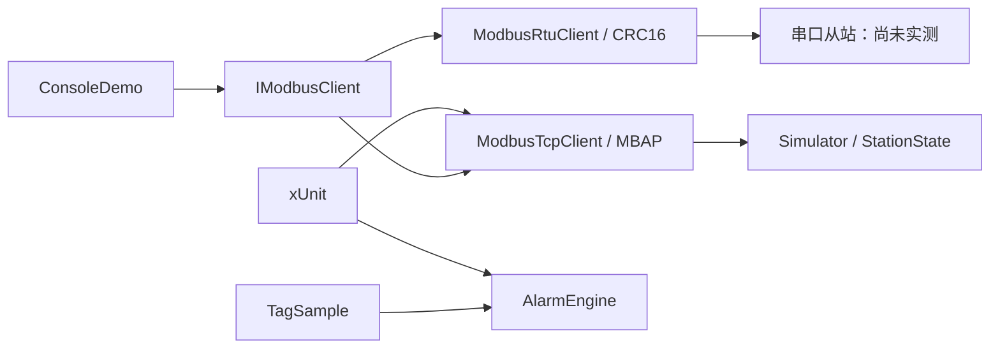

# 项目与运行说明

## 当前交付

- Core：无 WPF 依赖；自研 Modbus TCP/RTU，01/02/03/04/05/06/16 功能码。
- Simulator：本地 TCP 从站，站号 1，默认端口 1502，四类设备动态数据与故障注入。
- ConsoleDemo：真实 TCP 读写回读与 5 次液位采样；可指定 RTU 串口。
- Tests：协议、换算、报警状态机、真实 loopback TCP 集成测试。

后续 M2 增加 Data、Polling、Serilog；M3 增加 WPF App、登录和趋势；M4 接入报警持久化、历史、设置与控制；M5 做长时验收。图中仅展示已实现模块，当前还没有自动采集到报警引擎的宿主。

## 启动

安装 .NET 10 SDK，在项目根目录运行 `dotnet build -c Release` 和 `dotnet test -c Release`。

终端 A：`dotnet run --project src/PumpStationMonitor.Simulator -c Release -- 1502`。
终端 B：`dotnet run --project examples/PumpStationMonitor.ConsoleDemo -c Release -- 1502 --debug`。

示例先写 100 号寄存器并回读，再批量写 100～102，启动 1# 泵、读线圈与输入寄存器，采样 5 次后停泵退出。模拟器输入 `quit` 或 Ctrl+C 退出。端口占用时双方改成同一空闲端口。

RTU：`dotnet run --project examples/PumpStationMonitor.ConsoleDemo -c Release -- --rtu COM5 --debug`。
需要外部 RTU 从站或成对虚拟串口与 RTU 从站工具，使用 9600/8/E/1、站号 1，提供同样点表。自带模拟器仅提供 TCP，不会假装验证了串口硬件。

## 点表（零基地址，非 4xxxx 展示地址）

| 对象 | 保持寄存器地址 | 含义 | 换算 |
|---|---|---|---|
| 1# 泵 | 0 | bit0 运行、bit1 故障、bit2 远程、bit3 自动 | 位解析 |
| 1# 泵 | 1 / 2 / 3 | 电流 / 频率 / 累计运行 | ×0.1 A / ×0.1 Hz / h |
| 2# 泵 | 10 / 11 / 12 / 13 | 同上 | 同上 |
| 集水池 | 20 / 21 / 22 | 液位 / 进水流量 / 高低液位位 | ×0.01 m / ×0.1 m³/h / bit0 高、bit1 低 |
| 出水管路 | 30 / 31 / 32 | 压力 / 出水流量 / 阀门开度 | ×0.001 MPa / ×0.1 m³/h / ×0.1 % |
| 泵控制 | 40 / 41 | 写 0 停、非 0 启动 | 功能码 06 |
| 演示区 | 100～127 | 自由读写，不受周期模型覆盖 | 原始值 |

输入寄存器（04）每 200 ms 镜像保持寄存器；线圈（01/05）0、1 对应两泵启停；离散输入（02）0、1 是泵故障，2、3 是高低液位。模拟器地址空间各为 128 项，越界返回异常码 02。100 小时是初始模拟累计值，其后只累加运行时间。模型每次启动重置，不持久化。

## 故障注入

`fault 1` / `fault 2`：泵故障，运行状态关闭；`level 9.5`：锁定液位为 9.5 m；`offline`：保持连接但丢弃请求，不发应答，模拟黑洞超时；`recover`：恢复响应、故障和自然液位。命令生效后最迟 200 ms 更新模拟值。恢复不会清除已有启停命令。

## 通信边界

单客户端用 SemaphoreSlim 串行请求。读请求最多尝试 3 次，默认每次 2 秒超时，重试退避 200/400 ms，最大退避 10 秒；一轮失败后下次请求再次连接。没有无请求时的常驻重连线程，后续轮询宿主负责持续发起采样。

写入不自动重试：超时意味着结果未知，不能推断为未执行。TCP 逐段读满，验证事务号、协议号、站号、长度、功能码、字节数和写入回显。RTU 验证 CRC，帧间留静默间隔，超时关闭端口终止挂起读取。只支持地址 1～247，不支持广播。

报警引擎按每条规则独立输出产生、恢复、确认事件；HH/H/L/LL 是独立规则，可能同时触发。超过限值并持续达到延时才产生；恢复必须严格越过死区边界，确认只针对当前活动报警且幂等。坏质量不恢复报警，同时重置尚未触发的延时。尚无报警数据库/UI。

截图位置：M3 实现界面后补充真实截图；M1 输出证据见 `evidence/`。
